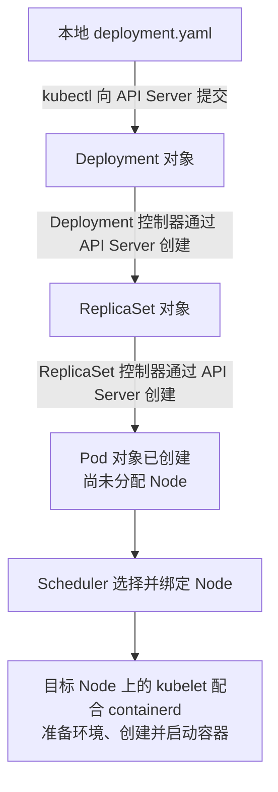

# P13：什么是资源

状态：课程笔记初稿，供后续学习使用；不代表用户已学完或掌握。

- 课程：[薪享宏福 Kubernetes v1.29，P13](https://www.bilibili.com/video/BV1PbeueyE8V/?p=13)。
- 分 P 标题：第四章.k8s资源清单-什么是资源1；时长约 11 分 37 秒。
- 资料：2026-10-28 登录后取得的 255 条中文 AI 字幕，已核对视频标识、分 P、时长与内容主题；未逐帧查看课件或核对音频。
- 明显的 Kubernetes、Pod 等识别错误已按上下文校正；无法可靠还原的缩写不强行补写。
- 课程 v1.29，实验集群快照 v1.22.2；下面只读练习尚未执行，不引入新版 YAML。

## 1 课程主线摘要

本节先介绍“资源类型”和具体“对象”的区别：同一种类型可以有许多配置不同的对象。随后讲资源的作用范围：Pod、Deployment、Service 等属于某个 Namespace；Node 和 Namespace 本身属于集群范围。不同 Namespace 可出现同名 Pod。课程特别提醒，K8s Namespace 与 Linux 内核 namespace 不是同一概念。

资源清单编写、Pod 生命周期和组件协同创建 Pod 是本章后续内容，本节主要建立概念。

回看位置：[02:00 资源与对象](https://www.bilibili.com/video/BV1PbeueyE8V/?p=13&t=120)、[05:38 Namespace](https://www.bilibili.com/video/BV1PbeueyE8V/?p=13&t=338)、[09:39 集群范围](https://www.bilibili.com/video/BV1PbeueyE8V/?p=13&t=579)。时间取自 AI 字幕，跳转位置为近似值。

## 2 助手补充：用运维经验理解

可以联系你在 Docker 中区分 container、image、network 的经验：先辨认管理的是哪一类东西，再定位某个具体实例。在 K8s 中，`Pod` 是一种对象的 Kind，而某个 Namespace 中有名字的 Pod 是具体对象；不能把 Pod 简单等同于镜像。

资源清单可以联系“用配置表达想要的状态”：比如希望应用保持三个副本。对象保存这些意图，系统组件持续协调实际状态。类比的边界在于，写下文件本身不代表集群已经接收或实现了配置；还需要通过 API 提交并观察状态。参见 [Kubernetes 对象](https://kubernetes.io/docs/concepts/overview/working-with-objects/)。

## 3 助手补充：避免形成错误印象

| 容易混淆的点 | 更准确的理解 |
| --- | --- |
| Namespace 像 Linux namespace 一样自动隔离进程与网络 | K8s Namespace 提供名称和管理范围；不能据此认定网络已被隔离。具体访问效果还取决于网络策略及其实现等配置。 |
| 所有资源都在某个 Namespace 中 | Node、Namespace 等属于集群范围；Pod、Deployment、Service 属于命名空间范围。 |
| “元数据型资源”是与前两者并列的第三种 API 作用范围 | 这是本节的教学分类说法。判断 API 资源作用范围时仍要查看是否 namespaced；不要将它与 YAML 的 `metadata` 字段混为一谈。 |
| 字幕中的 HPA “扩节点”可以直接记为增加机器 | HPA 调整目标工作负载的 Pod 副本数；增加集群机器属于节点伸缩，机制不同。 |
| HPA 依赖目标，所以不是独立 API 对象 | HPA 自身是 API 资源与对应控制器机制。它通过目标引用执行伸缩；依赖目标不等于只能作为别的对象的字段存在。 |

作用范围依据：[官方 Namespaces 文档](https://kubernetes.io/docs/concepts/overview/working-with-objects/namespaces/)。HPA 依据：[官方 Horizontal Pod Autoscaling 文档](https://kubernetes.io/docs/concepts/workloads/autoscaling/horizontal-pod-autoscale/)。HPA 相关字幕可能包含识别误差，以上补充依据官方机制，不据此断定讲者原话。

## 4 助手补充：Pod 从对象创建到容器运行

来源：2026-10-28 临时会话中的两次追问，按用户要求补入本笔记。这是围绕 P13 延伸的助手解释，不作为本节视频已经详细讲解的内容，也没有新增视频时间戳或画面证据。以下描述普通 Deployment 使用默认调度器创建 Pod 的流程，适用于项目记录的 v1.22.2 基础机制；没有连接集群核对实时状态。

### 4.1 Pod 的定义：容器的部署与调度单位

2026-10-29 追问补充：**Pod 是 Kubernetes 中最小的可部署、可调度单位，用来把一个或多个紧密关联的容器作为一个整体管理，并定义它们的运行要求和共享环境。** 同一 Pod 中的容器安排在同一个 Node 上，共享网络环境，也可以按配置挂载共享的存储卷；不代表各容器的整个根文件系统自动共享。

理解时区分同一 Pod 的两个层面：

- **API 对象层面**：Pod 对象保存 `metadata`（身份与标签等）、`spec`（容器及运行要求）和 `status`（系统观察到的状态）。对象创建成功，不代表应用容器已经启动。
- **节点运行层面**：kubelet 配合容器运行时，落实这个 Pod 的运行环境并创建、启动其中的容器。应用启动以后，Pod API 对象仍然存在，状态会被更新；对象不会“变成”容器后消失。

因此，“Pod 已创建”与“Pod 正在运行”是不同的判断。容器尚未启动、正在运行或已经结束时，Pod 对象都可能存在。可以把 API 对象类比为带状态回报的部署任务单，但 Pod 的完整含义还包括它所代表的一组容器及共享运行环境，不能仅定义成 YAML 文件或某个应用进程。

上述基础概念适用于本项目 v1.22.2，不涉及新版专属功能。依据：[官方 Pod 定义](https://kubernetes.io/docs/concepts/workloads/pods/)、[Pod 生命周期](https://kubernetes.io/docs/concepts/workloads/pods/pod-lifecycle/)。

### 4.2 先创建 Pod 对象，再选择 Node，最后启动容器

**创建 API 对象与启动应用进程，是两个不同的时刻。**



- Deployment、ReplicaSet 和 Pod 都是独立的 API 对象，通过 API Server 创建和更新，数据由 etcd 持久保存。图中的对象不是控制器在磁盘上依次生成的 YAML 文件。
- Deployment 控制器管理 ReplicaSet，ReplicaSet 控制器根据 Pod 模板维护所需的 Pod 数量；这条流程用的是 **RS（ReplicaSet）**。**RC（ReplicationController）**是另一种较早的副本控制资源。
- Pod 对象先记录镜像、资源请求、调度约束等要求。此时对象已存在，但尚未分配 Node，也没有该 Pod 的应用容器进程。
- Scheduler 为尚未分配节点的 Pod 选择已有 Node，通过 API Server 完成绑定；绑定后可在 Pod 的 `spec.nodeName` 中看到目标节点。
- 对应 Node 上的 kubelet 配合容器运行时落实运行。控制器和调度器不是在这里创建一台新 Node，也不会先把 Nginx 跑起来再寻找机器。

运维类比：登记部署工单 → 选择执行服务器 → 在服务器上执行部署。工单已存在，不代表部署已执行；这里仅用来区分“需求记录”和“实际运行”，K8s 还会持续协调状态。

### 4.3 Pod 已存在但未运行时会怎样

| 情况 | 可以观察到的状态与含义 |
| --- | --- |
| 已创建，等待调度 | 通常处于 `Pending`，未指定 Node，应用容器尚未启动 |
| 没有符合条件的 Node | Pod 暂时无法调度，调度器会重试；事件中可能说明资源不足或约束不满足 |
| 已分配 Node，正在准备环境或拉取镜像 | 仍可能处于 `Pending`，不能仅凭这个阶段认定“还没有选择 Node” |

`replicas: 2` 表达期望数量，不保证此刻已有两个正在运行的副本。判断卡在哪一步，需要结合节点分配、条件和事件；上述情况是概念说明，并非本次集群输出。

### 4.4 已调度、Running 和 Ready 是不同判断

2026-10-29 追问补充：Pod 已绑定 Node，应用容器仍可能无法启动。例如镜像名称或凭据错误导致拉取失败，存储卷挂载或网络准备失败；应用也可能启动后因配置错误退出并反复重启。这些是可能的故障示例，不是本次集群已发生的故障。

| 观察项 | 表达的含义 |
| --- | --- |
| `PodScheduled=True`／已记录目标 Node | Pod 已安排到节点；不保证应用容器已启动 |
| Pod 阶段为 `Running` | 已绑定节点，容器均已创建，至少一个仍在运行、启动或重启；不保证全部容器就绪 |
| Pod 条件 `Ready=True` | Kubernetes 按就绪规则判断该 Pod 可以接收请求 |
| Pod 列表 `READY 1/1` | 这个 Pod 配置的 1 个普通容器中，1 个被判定就绪；与整个 Pod 的 Ready 条件不是同一字段 |

容器运行和容器就绪不同：应用进程可能已经启动，但仍在加载数据或等待依赖。配置 `readinessProbe` 后，kubelet 根据检查结果判断是否就绪；没有配置该探针时，容器通常在启动完成后被判定就绪，不会自动验证所有业务功能。就绪状态也可以在运行期间改变。

对本项目的普通 Pod，全部容器就绪是 Pod 就绪的核心条件；如果另行配置了 `readinessGates`，还必须满足这些附加条件。假设一个单容器 Pod 显示 `NODE=node1`、`STATUS=Running`、`READY=0/1`，说明已分配节点、处于 Running 阶段但没有就绪容器；一种可能是应用进程仍在运行，而就绪探针未通过。具体原因仍需看容器状态、条件、事件和日志，不能直接认定是某一种故障。

版本核对：[Kubernetes v1.22 官方生命周期文档源码](https://github.com/kubernetes/website/blob/release-1.22/content/en/docs/concepts/workloads/pods/pod-lifecycle.md)、[官方就绪探针说明](https://kubernetes.io/docs/tasks/configure-pod-container/configure-liveness-readiness-startup-probes/#define-readiness-probes)。这里不引入新版的 Pod 就绪条件。

### 4.5 调度依据来自 Pod 配置与集群情况

Deployment 的 `spec.template` 是 Pod 模板，经 ReplicaSet 传递到实际 Pod。Scheduler 通过 API Server 获取和监听 Pod、Node 等对象，通常维护本地缓存；它不会读取用户电脑上的 `deployment.yaml`，也不直接到 etcd 查询 Pod。

| Deployment 中的位置 | 实际 Pod 中的位置或作用 |
| --- | --- |
| `spec.template.spec.containers` | `spec.containers`，包括镜像、容器资源请求等 |
| `spec.template.spec.nodeSelector` | `spec.nodeSelector`，约束节点标签 |
| `spec.template.metadata.labels` | `metadata.labels` |
| `spec.replicas` | 控制器的目标副本数，不是每个 Pod 的调度位置 |

默认调度可以先理解为 **筛选 → 评分 → 绑定**：先排除资源额度不足、节点标签不匹配、不允许调度或不满足其他要求的节点，再按评分规则综合选择。其他约束还包括污点与容忍、亲和性、存储条件等，后续逐项学习。

CPU、内存的容量判断主要依据 `requests` 的资源账本：节点可分配资源，以及已安排在该节点上的 Pod 请求了多少资源；不是简单查看 `top` 后选择实时利用率最低的机器。

简化示例：新 Pod 请求 `256Mi` 内存；node1 按资源请求计算只剩 `128Mi` 可安排额度，node2 还剩 `512Mi`，且其他条件都满足，则 node1 不满足要求，Pod 可以安排到 node2。这是假设数据，不是实际测量。两个副本也不保证自动各占一台 Node；明确的分散要求需要通过调度约束表达。

### 4.6 Pod 配置在哪里，如何读取

**配置来自模板，但生成的是 Pod API 对象，而不是一份自动落盘的 `pod.yaml`。** 用户和 Scheduler 都经由 API Server 访问对象。`kubectl get ... -o yaml` 只是把读到的当前对象按 YAML 格式显示出来。

执行位置：已配置访问权限的 master 终端。以下命令由用户亲手执行，本次尚未执行。先取得实际命名空间和 Pod 名称：

```bash
kubectl get pods -A -o wide
```

用途与预期：列出 Pod，查看 `NAMESPACE`、`NAME`、`NODE` 等列；尚未分配节点时，`NODE` 可能显示 `<none>`。然后将下面的 `POD_NAME`、`NAMESPACE` 替换为实际值：

```bash
kubectl get pod POD_NAME -n NAMESPACE -o yaml
```

用途与预期：读取当前 Pod 对象，关注 `metadata`（身份、标签、所属控制器）、`spec`（镜像、资源请求、调度条件）和 `status`（状态信息）。系统会补充名称、UID、默认值等，输出通常比最初的模板更完整；调度后可查看 `spec.nodeName`。即使 Pod 尚未分配 Node，这个对象也能被查询，不需要登录未来承载它的节点。

官方依据：[Deployment](https://kubernetes.io/docs/concepts/workloads/controllers/deployment/)、[ReplicaSet](https://kubernetes.io/docs/concepts/workloads/controllers/replicaset/)、[Pod 生命周期](https://kubernetes.io/docs/concepts/workloads/pods/pod-lifecycle/)、[调度器](https://kubernetes.io/docs/concepts/scheduling-eviction/kube-scheduler/)、[资源请求](https://kubernetes.io/docs/concepts/configuration/manage-resources-containers/)、[API 对象与监听](https://kubernetes.io/docs/reference/using-api/api-concepts/)、[读取 Pod 详情](https://kubernetes.io/docs/tasks/debug/debug-application/debug-running-pod/)。本次问答已查阅这些官方资料，笔记未采用新版专属调度字段。

## 5 可选只读练习

执行位置：已配置集群访问权限的 master 终端。状态：尚未执行，下面列出预期观察，不是实际结果。

```bash
# 查看属于某个 Namespace 的资源类型
kubectl api-resources --namespaced=true

# 查看不属于任何 Namespace 的资源类型
kubectl api-resources --namespaced=false

# 对比“命名空间对象”和“各命名空间中的 Pod 对象”
kubectl get namespaces
kubectl get pods -A
```

预期：前两条列出资源类型与作用范围；后两条列出实际对象。可以观察 Namespace 本身属于集群范围，而 Pod 输出带有 `NAMESPACE` 列。这组查询写法来自 [官方作用范围查询示例](https://kubernetes.io/docs/concepts/overview/working-with-objects/namespaces/#not-all-objects-are-in-a-namespace)。

## 6 学习中的问题与解答

### 6.1 2026-10-28：Node 下面是否各自有 Namespace？元数据资源是否依附于其他资源？

- 问题原意：从三类资源理解 K8s 架构，用户暂时把关系理解为集群 → Node → 各自的 Namespace → Pod／ConfigMap，以及依附于其他对象的元数据资源。
- 视频位置：对应字幕约 05:21–11:08；用户实际播放时间未提供。已复用校验过的 P13 AI 字幕，CID 为 `500001651183323`，未核对课件画面或音频。
- 助手补充解答：Namespace 表示管理归属，Node 表示运行位置，两者交叉而非上下层级；同 Namespace 的不同 Pod 可以分布在不同 Node，同 Node 也能运行不同 Namespace 的 Pod。ConfigMap 是配置对象，本身不作为进程运行。
- 分类澄清：Node 与 Namespace 本身是集群作用域资源；Pod、ConfigMap、HPA 是命名空间作用域资源。“元数据型资源”不能当作第三种 API 作用域。`metadata` 是对象的字段；HPA 是独立 API 对象，通过引用目标工作负载来调整副本；Deployment 的 Pod 模板、容器 requests/limits 是嵌入配置。
- 架构衔接：资源对象表达管理数据或期望状态；API Server、etcd、控制器、Scheduler、kubelet 和容器运行时负责保存、协调与落实。
- 口头复盘：用户对“dev 的两个 Pod 分别在 node1、node2，共几个 dev Namespace”回答：“1个，namespace跟pod和node无关，namespace的数量需要命令创建”。数量正确；“与 Pod 无关”的理由需要纠正。
- 助手纠正：Pod 属于 Namespace，并被分配到 Node；Namespace 不隶属于 Node，数量不会随 Pod／Node 数量自动增加。Namespace 可以通过命令、YAML 或其他 API 客户端创建，集群也有预置命名空间，不全是用户手动创建。
- 实践证据与状态：**部分口头验证，仍有待巩固点**；仅本例数量判断得到验证，归属关系纠正及 metadata／HPA 区别尚未验证。没有集群操作。时长未知，暂存于 [PENDING.md](../PENDING.md)，待后续同主题合并。
- 下一步：巩固“Pod 属于 Namespace、运行在 Node”，再由用户在 master 使用 `kubectl get pods -A -o wide` 对照归属与运行位置。

### 6.2 2026-10-28：先创建 Pod，还是先选择 Node？调度根据什么配置？

- 来源与问题原意：临时会话追问控制器创建 Pod 与 Scheduler 分配 Node 的先后；如果先创建但不运行会怎样，以及选择节点是否依据 Deployment 配置。问题来自架构讲解的延伸，不标为视频原话或特定时间点。
- 助手解答：先创建 Pod API 对象，再调度绑定已有 Node，最后由 kubelet 配合 containerd 启动容器。未调度时对象可以存在并处于 Pending；已调度但尚未完成启动准备也可能 Pending。调度器读取由 Deployment 模板生成的 Pod 配置，并结合节点资源、约束与评分规则做决定。
- 用户掌握证据与验证：用户继续追问配置的存放与读取位置，随后评价本次讨论有意义并要求保存；未提供独立复述或实验输出。
- 状态：**已解释未验证**；实际学习时长未知。
- 下一步：用 `kubectl get pods -A -o wide` 对照状态与节点分配；存在 Pending 时再结合条件和事件定位，不能预先假设集群一定存在 Pending Pod。

### 6.3 2026-10-28：生成后的 Pod 配置在哪里？是不是 RC 生成的配置文件？

- 来源与问题原意：临时会话中询问调度器在哪里读取生成后的 Pod 配置；用户当时理解为 Deployment 经过“RC”创建后生成配置文件。
- 助手解答：这里是 RS（ReplicaSet）。控制器根据模板向 API Server 创建 Pod 对象，由 etcd 持久保存，没有必须生成的 Pod YAML 文件。Scheduler 经由 API Server 获取和监听对象；用户可用 `kubectl get pod POD_NAME -n NAMESPACE -o yaml` 查看。YAML 是输出格式，对象还会包含默认值、身份信息和状态。
- 用户掌握证据与验证：用户认可讨论价值并明确要求补入学习笔记；尚无读取命令的实际输出，不将保存笔记记为已掌握。
- 状态：**已解释未验证**；实际学习时长未知。
- 下一步：读取一个实际 Pod 的 YAML，辨认 `metadata`、`spec`、`status`，对照 Deployment 的 `spec.template`，验证模板字段与独立对象的区别。

### 6.4 2026-10-29：Pod 不等于正在运行的容器，那该怎样定义？

- 问题原意：用户选中“先创建 Pod 对象，再调度，再由 kubelet 配合运行时启动容器”的说明，推导出 Pod 对象存在时应用容器可能尚未运行，询问更准确的 Pod 定义。
- 相关知识点：Pod 的部署与调度单位、API 对象与实际运行、`metadata`／`spec`／`status`、同一 Pod 内容器的共享环境。
- 助手解答：Pod 是 Kubernetes 中最小的可部署、可调度单位，把一个或多个紧密关联的容器作为整体管理，包含运行要求和共享环境。Pod 对象记录身份、要求和观察状态；Node 上由 kubelet 配合容器运行时落实运行。容器启动前后，Pod 对象都可以存在；启动不会把对象转换成容器。Pod 内容器在同一 Node 上，共享网络，也可按配置共享存储卷。
- 类比边界：部署任务单适合解释 API 对象先存在、部署后落实并回报状态；不能据此把 Pod 的完整概念缩减为一份配置文件，也不能把它等同于某个运行中的应用进程。
- 用户掌握证据：用户已正确复述本例中 RS 创建对象、Scheduler 调度、kubelet 落实运行的顺序，并主动区分对象创建与容器启动。完整定义与共享资源边界为本次助手补充，尚未复述验证；本次没有新增实验，也没有连接服务器。
- 来源与状态：围绕既有 P13 笔记的补充问答，不是新读取的视频内容；观看位置保留 P14，实际学习时长未知。**部分理解已有用户推导证据，完整定义已解释未验证。**

### 6.5 2026-10-29：Pod 分配到 Node 后会不会启动失败？Ready 表示什么？

- 问题原意：用户询问 Pod 已分配 Node 后，实际容器是否可能运行不起来；Pod Ready 究竟表示调度完成，还是容器已经正常运行。
- 相关知识点：调度绑定、容器启动失败、Pod 阶段与条件、容器就绪计数、readinessProbe。
- 助手解答：调度成功不保证容器成功启动，镜像拉取、存储或网络准备、应用配置等都可能影响启动或持续运行。PodScheduled 表示已调度，Running 不保证全部容器就绪，Ready 表示按就绪规则判断可接收请求。Pod 列表 READY 统计就绪容器数／配置容器数；Pod 条件 Ready 还会考虑已配置的 readinessGates。
- 判定边界：readinessProbe 可检查应用是否已准备好；未配置时通常容器启动完成即可被判定就绪，不能把 Ready 理解为所有业务功能已通过验证。进程运行但检查未通过时，可以出现 Running、READY 0/1。
- 验证结果与状态：本次是概念提问，所有故障和状态例子均为助手说明，没有新增集群输出、实验或考题；**已解释未验证**。保留之前对 READY 数字计数已正确作答的证据，不因本次追问抹去已有理解。
- 来源：已核对 v1.22 官方生命周期文档；本条属于助手补充，不是视频内容提取。学习位置仍为 P14，实际学习时长未知。

### 6.6 2026-10-29：严格检查从 Deployment 到容器启动的流程复述

- 用户复述原意：controller 根据 Deployment 指挥 RS 创建 Pod，Pod 信息写入 etcd 后完成创建，再将数据分配给 Scheduler；Scheduler 选择 Node，Node 使用 kubelet 和节点上的“容器”创建实际容器。用户要求严格检查。
- 已有理解证据：整体顺序正确，能区分 Pod 对象创建与容器进程启动，知道 etcd 保存对象、Scheduler 选择 Node、kubelet 参与节点运行。不将这些正确部分与后续修正混为一谈。
- 修正一：Deployment 控制器创建或更新 RS 对象；ReplicaSet 控制器根据 RS 的期望副本数和模板创建 Pod 对象。Deployment、RS、Pod 都是对象；真正执行协调的是相应控制器，不能把 RS 对象本身当成执行程序。
- 修正二：Pod 创建请求由 RS 控制器提交给 API Server，经处理后持久化到 etcd。这里完成的是 API 对象的创建，控制器不直接把对象写入 etcd，etcd 也不负责主动创建或调度应用。
- 修正三：不是将“待创建 Pod 的信息”另行分配给 Scheduler。Scheduler 通过 API Server 获取和监听已创建、尚未绑定节点的 Pod，选择合适节点，再通过 API Server 提交绑定。Pod 对象的 spec.nodeName 随绑定结果记录目标节点。
- 修正四：目标节点的 kubelet 通过 API Server 获取和监听分配给本节点的 Pod，调用容器运行时落实运行。本项目为 containerd；应说“kubelet 配合容器运行时创建、启动容器”，不是用已有应用容器创建新容器。
- 补全：kubelet 将观察到的 Pod／容器状态报告给 API Server；API 对象及其状态由 etcd 持久保存。控制器、调度器和 kubelet 通过 API 对象协同，各自持续观察和处理变化，不是只执行一次的串行脚本。调度仅是这条部署流程中的选节点与绑定环节。
- 适用范围：本次描述 Deployment 管理的普通 Pod 使用默认调度器的流程，沿用项目 v1.22.2 环境，不泛化为所有 Pod 的唯一创建路径。官方依据：[ReplicaSet](https://kubernetes.io/docs/concepts/workloads/controllers/replicaset/)、[Kubernetes API](https://kubernetes.io/docs/concepts/overview/kubernetes-api/)、[调度器](https://kubernetes.io/docs/concepts/scheduling-eviction/kube-scheduler/)、[kubelet 协调循环](https://kubernetes.io/docs/reference/node/kubelet-sync-loop/)。
- 验证结果：**整体时序有用户复述证据，组件职责与通信细节部分待纠正**。上述四处修正及状态回报为助手补充，尚未得到用户修正后的复述；没有新增实验或考题。视频位置仍为 P14，实际学习时长未知。

## 7 待拓展与下次起点

先复盘本次资源作用域与运行位置的区别，再结合上面四条只读命令，区分“资源类型列表”和“对象列表”。随后可学习 YAML 中 `apiVersion`、`kind`、`metadata`、`spec` 的作用，以及控制器如何协调期望状态与实际状态。

观看位置、掌握程度、实际时长与卡点仍以 [当前进度](../PROGRESS.md) 和 [短时暂存](../PENDING.md) 为准。
