# P14–P25 关键画面核对

核对日期：2026-10-29。来源为 [BV1PbeueyE8V](https://www.bilibili.com/video/BV1PbeueyE8V/?p=14) 的对应分 P。以下 12 帧均通过视频流在指定时刻解码为 1920×1080 PNG，先看总览、再由主代理逐张实际查看，并与完整字幕阅读结果交叉核对。不是仅下载缩略图后推测内容。

每节仅抽查一帧，不代表连续画面、全部代码或实验结果均已检查。原始缓存及提取元数据在 `.local/`；这里保留必要教学插图。CID 与来源总表见 [预习索引](P014-P025-预习索引.md)，解释与官方纠正见各组精读笔记。图中机器、时间、IP 和输出属于课程环境，不是用户集群的实测结果。

## 1 P14 · 27:45 · 双容器 Pod 清单

[回到原视频](https://www.bilibili.com/video/BV1PbeueyE8V/?p=14&t=1665)。CID：500001651184251。

可辨认 `apiVersion: v1`、`kind: Pod`，对象名 `pod-demo`，namespace 为 default，标签 `app: myapp`。两个容器为 `myapp-1`（`wangyanglinux/myapp:v1.0`）与 `busybox-1`（`wangyanglinux/tools:busybox`）；后者通过 `/bin/sh -c` 执行 `sleep 3600`。画面核对解决了 AI 字幕对镜像名、BusyBox 和 command 的误识别；没有核验这些镜像目前能否拉取。

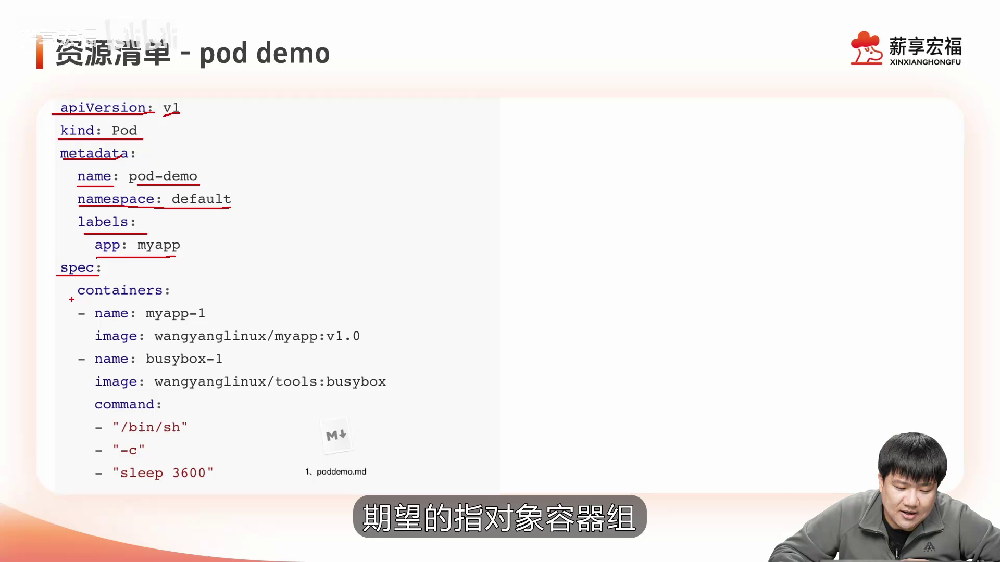

## 2 P15 · 30:24 · 端口冲突日志

[回到原视频](https://www.bilibili.com/video/BV1PbeueyE8V/?p=15&t=1824)。CID：500001651187296。

课程的 `pod-demo-1` 显示 READY 1/2、CrashLoopBackOff。对 `myapp-2` 读取日志后出现 `bind() to 0.0.0.0:80 failed (98: Address in use)`。与同 Pod 容器共享网络、两个应用争用相同监听地址和端口的解释一致。这里能确认该课程实例的日志，不能把 CrashLoopBackOff 一律归因为端口冲突。

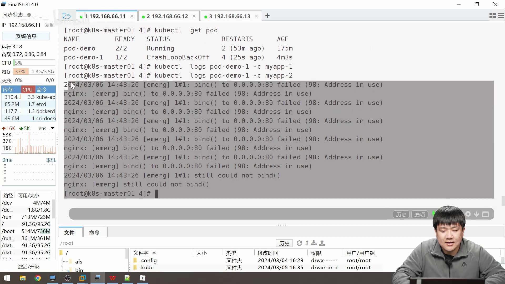

## 3 P16 · 06:45 · init 时间轴

[回到原视频](https://www.bilibili.com/video/BV1PbeueyE8V/?p=16&t=405)。CID：500001651190464。

图中有横跨生命周期的 pause 条，以及依次布置的 initc-1、initc-2。此刻正在编辑第二个 init 形状，适合辅助理解顺序执行；画面自身不证明“后一个失败，所有前面的都重跑”。普通失败重试与初始化重新执行的边界已在 P16 精读中依据官方资料纠正。

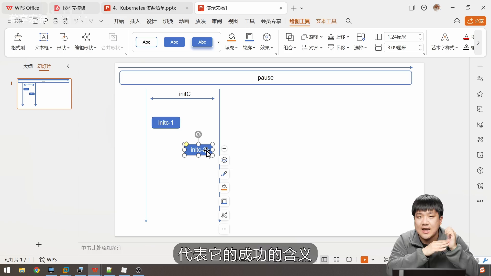

## 4 P17 · 08:16 · 等待 DNS 的 init 示例

[回到原视频](https://www.bilibili.com/video/BV1PbeueyE8V/?p=17&t=496)。CID：500001651192877。

Pod 名 `initc-1`；`init-myservice`、`init-mydb` 分别循环执行 `nslookup myservice`、`nslookup mydb`，失败时等待 2 秒。应用容器打印信息后 `sleep 3600`。下方展示创建对应 ClusterIP Service 的命令。这里只检查名称能否解析；即使退出码成功，也不能证明数据库已就绪、后端存在或业务请求成功。

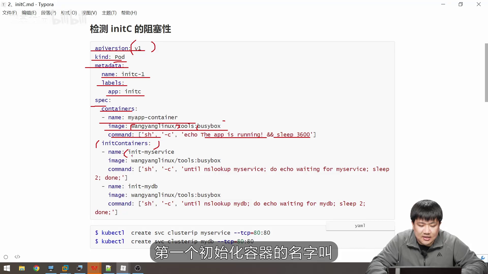

## 5 P18 · 12:10 · Service 标签与就绪

[回到原视频](https://www.bilibili.com/video/BV1PbeueyE8V/?p=18&t=730)。CID：500001651195252。

图中选择条件为 `app=myapp`，被选 Pod 可有额外 `version=v1` 标签；另一个 `app=test` 不满足。画面强调匹配和就绪，并用 IPVS 描绘转发。它是课程示意，不能据此认定用户集群 kube-proxy 当前运行在 IPVS 模式；未配置额外例外时，readiness 会影响 Service 的正常后端选择。

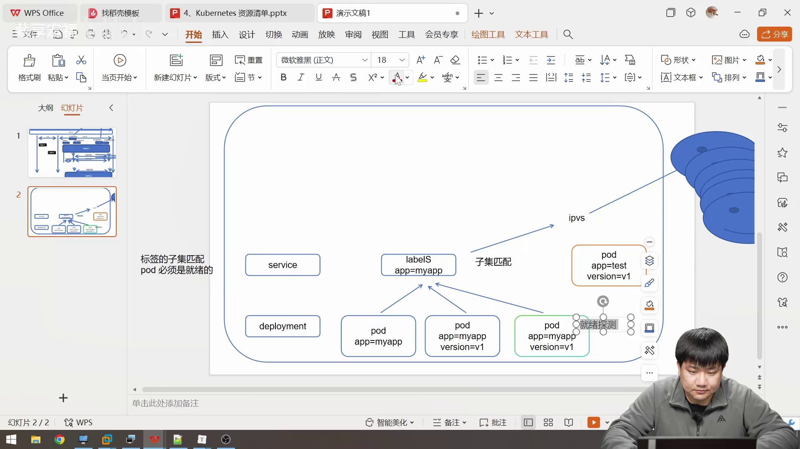

## 6 P19 · 06:45 · exec readiness

[回到原视频](https://www.bilibili.com/video/BV1PbeueyE8V/?p=19&t=405)。CID：500001651198150。

Pod 名 `readiness-exec-pod`。容器先创建 `/tmp/live`，等待 60 秒后删除，再休眠；readiness 执行 `test -e /tmp/live`，`initialDelaySeconds: 1`、`periodSeconds: 3`。这套设计用于观察运行中就绪状态变化，不应理解成 readiness 只在第一次成功前执行。截图只确认配置文本，没有在本集群运行。

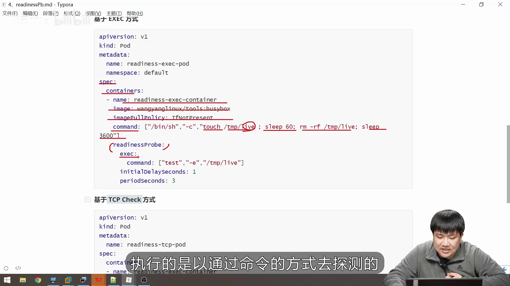

## 7 P20 · 04:50 · startup 与 readiness 分别探测

[回到原视频](https://www.bilibili.com/video/BV1PbeueyE8V/?p=20&t=290)。CID：500001651201097。

Pod 名 `startupprobe-1`，镜像 `wangyanglinux/myapp:v1.0`。readiness 的 HTTP 路径是 **`/index2.html`**，端口 80，初始延迟 1 秒、间隔 3 秒；startup 是 **`/index1.html`**，端口 80，`failureThreshold: 30`、`periodSeconds: 10`。底部虽有字幕覆盖，两个数值仍可辨认。两条探针不是同一路径；此帧也没有配置 `successThreshold: 3`，不能用口述的该数值构造有效 startup 配置。

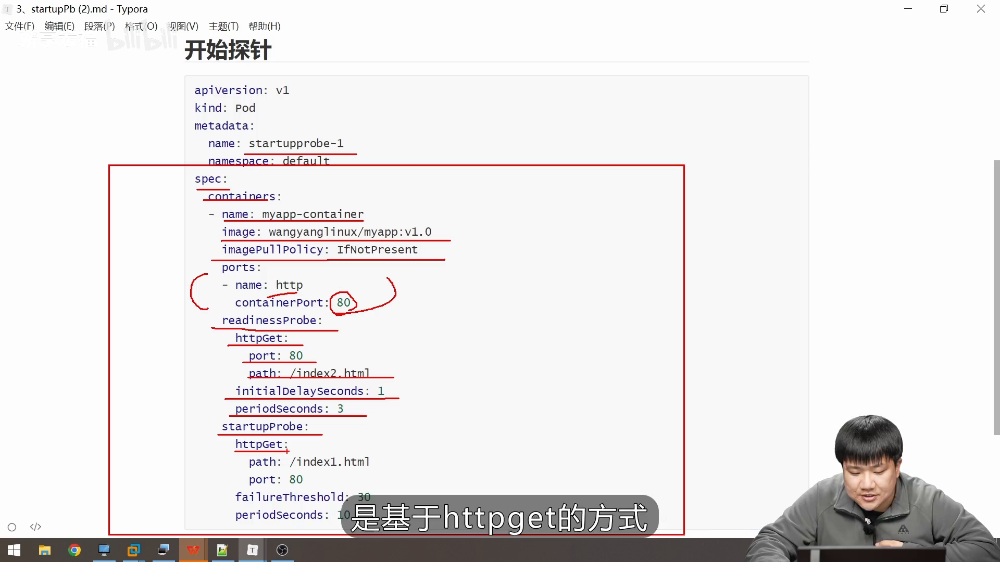

## 8 P21 · 02:40 · 提交、调度和运行

[回到原视频](https://www.bilibili.com/video/BV1PbeueyE8V/?p=21&t=160)。CID：500001651203545。

图展示 Docker 推镜像、kubectl 发 REST 请求、API 服务和调度器、节点 kubelet 与 Docker，另手写标注 etcd。本项目应用时需换成 kubelet 经 CRI 调用 containerd 的实际环境。图中 `kubectl run ... --port=8080` 在本项目 v1.22 用于创建 Pod，不能视为创建 Deployment 或 Service；从 API 对象创建、调度绑定到运行时启动容器仍是不同步骤。

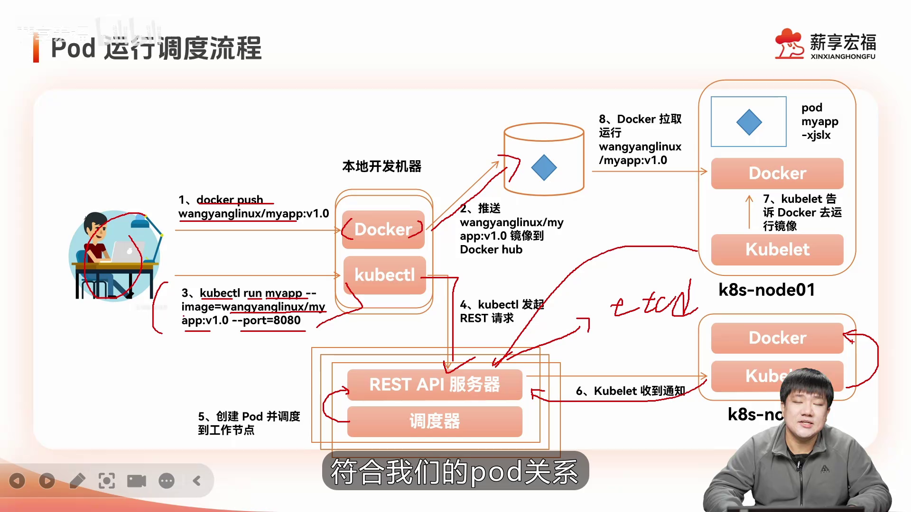

## 9 P22 · 05:50 · 控制循环

[回到原视频](https://www.bilibili.com/video/BV1PbeueyE8V/?p=22&t=350)。CID：500001651203929。

左侧期望 `replicas: 8`，右侧两个工作节点各画 4 个 Pod，中间为检查、比较、调整的循环。这是理想化状态示意，不表示控制器保证平均分布，也不是真实查询输出；副本控制与调度位置选择需分开。

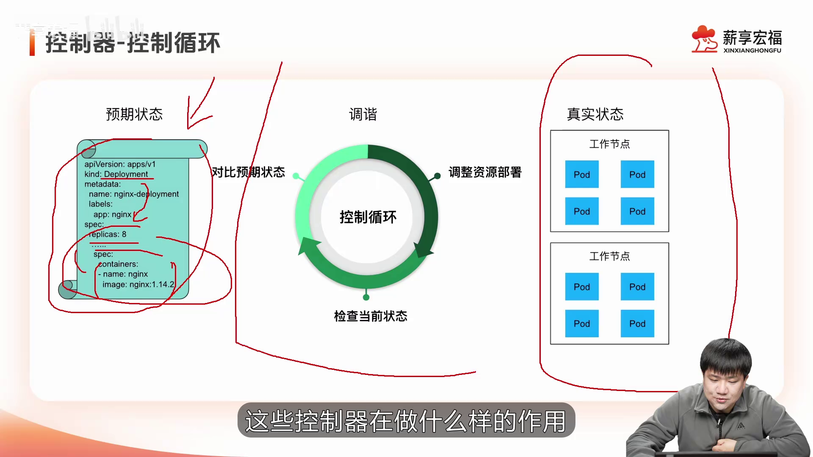

## 10 P23 · 08:58 · RC 清单与列表细节

[回到原视频](https://www.bilibili.com/video/BV1PbeueyE8V/?p=23&t=538)。CID：500001651204363。

RC 名 `rc-demo`，replicas 为 3；selector 与 template 标签均为 `app: rc-demo`，容器 `rc-demo-container`，镜像 `wangyanglinux/myapp:v1.0`，端口 80。画面中第二个环境变量 `name: zhangsan` 前没有列表连字符，不能原样作为两个有效 env 条目照抄。这里记录的是当时屏幕，不推定讲师后续一定未修正；完整执行文件需另核对。

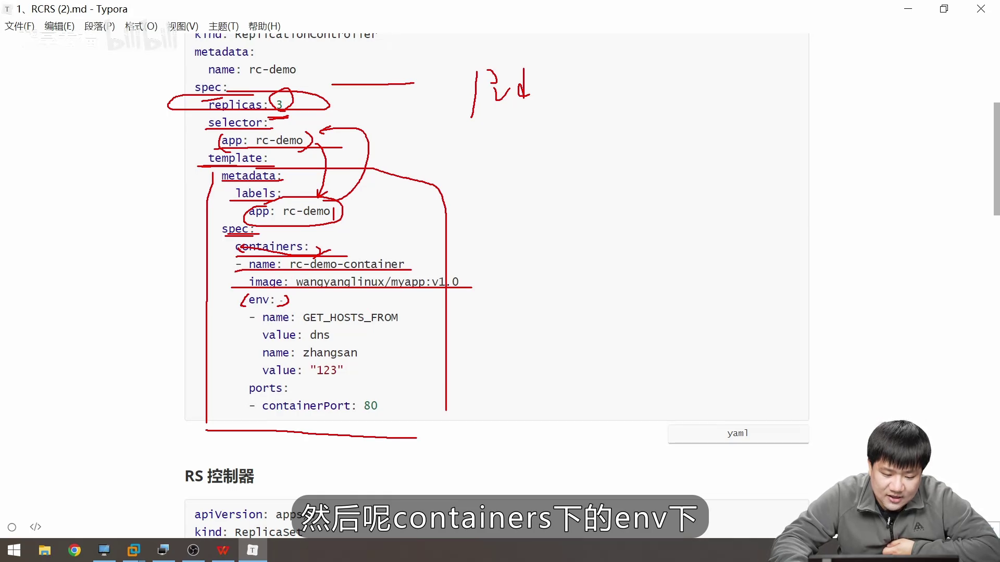

## 11 P24 · 08:45 · 选择器与模板尚未匹配

[回到原视频](https://www.bilibili.com/video/BV1PbeueyE8V/?p=24&t=525)。CID：500001651206687。

`apps/v1` 的 ReplicaSet 名为 `rs-me-in-demo`；`matchExpressions` 条件是 key=app、operator=In，候选值为 `spring-k8s`、`hahahah`，模板却是 `app: sg-k8s`。当前模板不满足选择器，不能作为创建成功的清单。字幕随后讲到创建遭拒和修正，这张帧是错误引入过程的一部分。

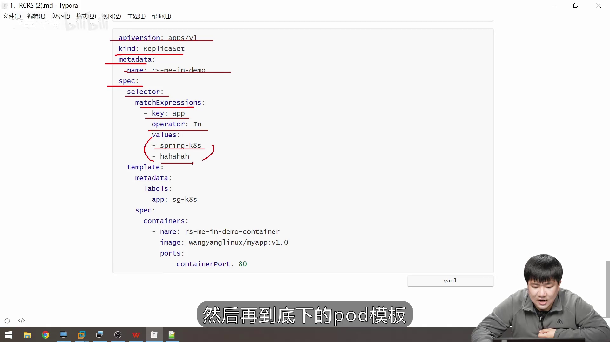

## 12 P25 · 27:20 · 正在编辑的滚动更新图

[回到原视频](https://www.bilibili.com/video/BV1PbeueyE8V/?p=25&t=1640)。CID：500001651208340。

Deployment 写 replicas=3、镜像 v2.0；旧蓝色 RS 写 replicas=2、镜像 v1.0，新橙色 RS 写 replicas=1，但镜像文字此时仍为 v1.0，底部仍画 3 个旧 Pod。此刻图尚未同步完成，不能当成一致的真实集群快照。若新 RS 对应 v2.0 的 Pod 模板，它的镜像应是 v2.0；精确扩缩步骤还受更新策略和 Ready 状态约束。

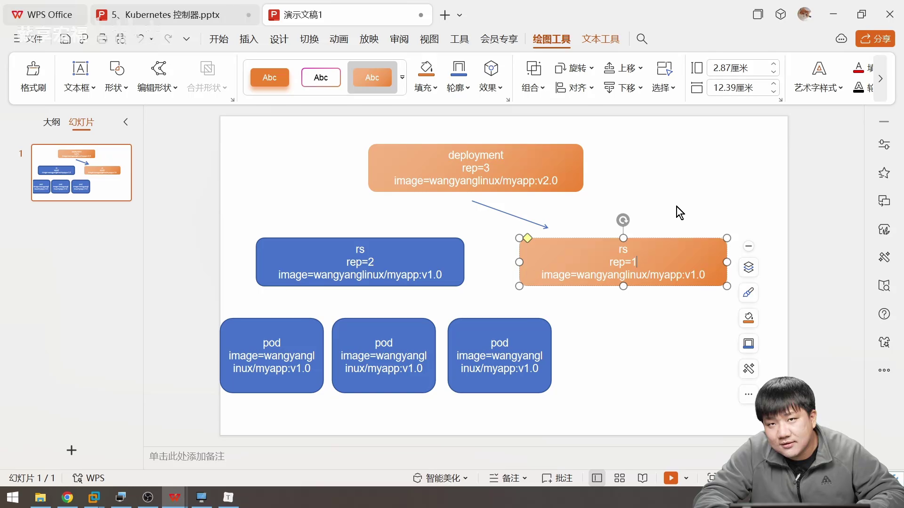

## 13 学习中的问题与解答

本文件是助手的画面核验记录，没有新增用户问答或实验结果。用户真实请求及准备结果见 [预习索引](P014-P025-预习索引.md)，此前问答保留于 [学习暂存](../PENDING.md)。
