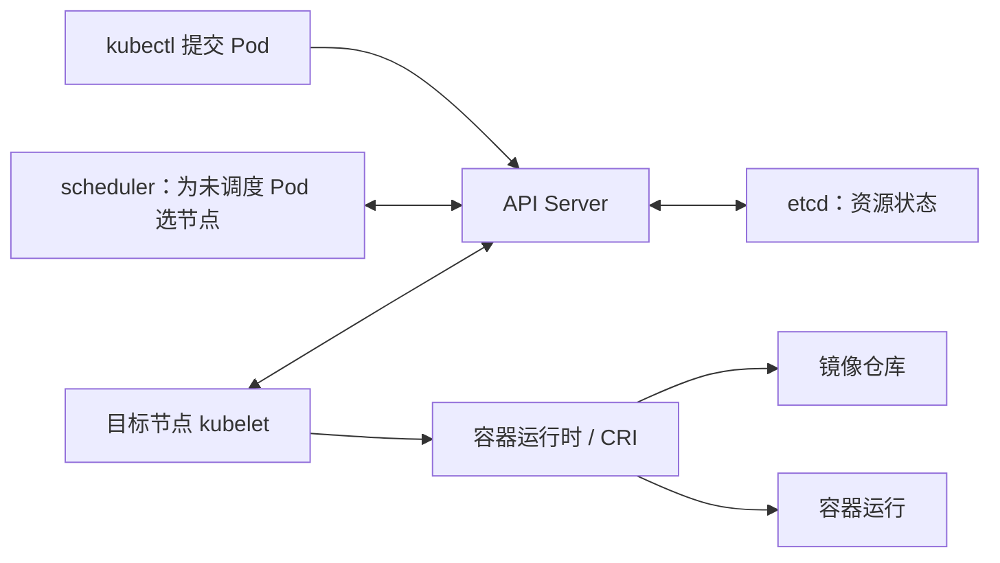

# P18–P21 预习精读

本记录用于用户后续学习时快速回查。它记录助手提前审阅的内容，不表示用户已经看完、理解或独立完成实验。没有连接三台虚拟机，没有执行本批课程中的创建、删除、故障注入等操作。

## 1 来源与读取范围

原课程：[BV1PbeueyE8V](https://www.bilibili.com/video/BV1PbeueyE8V/)。逐节完整读取已获取的 AI 中文字幕，并核对 `source.json` 的分 P、CID、标题和时长。原始资料保存在项目 `.local/bilibili/BV1PbeueyE8V/P018` 至 `P021`，不进入正式笔记正文。

| 分 P | 官方分集标题 | CID | 元数据时长 | 字幕条数 | 最后字幕结束 |
|---|---|---|---|---:|---|
| [P18](https://www.bilibili.com/video/BV1PbeueyE8V/?p=18) | 第四章.k8s资源清单-Pod的生命周期3 | 500001651195252 | 27:25 | 617 | 27:22.87 |
| [P19](https://www.bilibili.com/video/BV1PbeueyE8V/?p=19) | 第四章.k8s资源清单-Pod的生命周期4 | 500001651198150 | 28:31 | 642 | 28:25.36 |
| [P20](https://www.bilibili.com/video/BV1PbeueyE8V/?p=20) | 第四章.k8s资源清单-Pod的生命周期5 | 500001651201097 | 30:30 | 670 | 30:24.72 |
| [P21](https://www.bilibili.com/video/BV1PbeueyE8V/?p=21) | 第四章.k8s资源清单-Pod如何被调度运行1 | 500001651203545 | 03:51 | 79 | 03:45.34 |

合计 2,008 条字幕，视频元数据时长 1 小时 30 分 17 秒；这是材料时长，不是用户学习时长。四节字幕主题与标题一致，未发现字幕在正文中途整体截断的迹象。AI 字幕中的专业词、镜像名、路径和参数经常误识别，不能当作逐字符命令来源。

**画面读取范围：**本稿由完整字幕整理；根代理另行实际检查了 P18 12:10、P19 06:45、P20 04:50、P21 02:40 的高清帧，下文已合入其核验结论。见 [本批关键画面核对](P014-P025-关键画面核对.md)。本文件整理者未独立逐帧观看完整视频，未核验的 YAML 不拼接成“课程原文件”。

## 2 P18：探针总览，以及 Service 为什么需要 readiness

### 2.1 课程讲解主线与回查点

| 回查位置 | 课程内容与前后联系 |
|---|---|
| [00:27](https://www.bilibili.com/video/BV1PbeueyE8V/?p=18&t=27)–03:27 | 探针由 Pod 所在节点的 kubelet 发起；介绍 exec、TCP、HTTP 三种检查方式，以及成功、失败、未知三类结果。exec 看退出码，TCP 看连接能否建立，HTTP 看状态码。 |
| [03:35](https://www.bilibili.com/video/BV1PbeueyE8V/?p=18&t=215)–06:58 | 区分 startup、liveness、readiness。随后引入多副本应用：即使容器进程已启动，也可能还没有准备好接收请求。 |
| [07:03](https://www.bilibili.com/video/BV1PbeueyE8V/?p=18&t=423)–12:23 | Service 通过标签选择 Pod。Pod 可以拥有额外标签，只要满足 selector 的全部条件即可。新增副本的标签可以立即匹配，但应用尚未就绪，readiness 用来避免过早接流量。 |
| [12:31](https://www.bilibili.com/video/BV1PbeueyE8V/?p=18&t=751)–14:49 | 讲解首次延迟、探测间隔、超时、连续成功和连续失败阈值；后面每种探针的 YAML 都会重复使用这些字段。 |
| [15:00](https://www.bilibili.com/video/BV1PbeueyE8V/?p=18&t=900)–19:53 | 讨论未配置 readiness 的情况，然后清理之前的 Pod 和 Service，为实验准备环境。课程展示了删除指定对象和按资源类型删除全部对象的方式。 |
| [20:03](https://www.bilibili.com/video/BV1PbeueyE8V/?p=18&t=1203)–22:18 | 创建两个带目标标签的 Pod，其中一个附带额外版本标签；使用显示标签的查询确认对象。 |
| [22:23](https://www.bilibili.com/video/BV1PbeueyE8V/?p=18&t=1343)–27:22 | 创建 ClusterIP Service，访问其虚拟 IP，按返回的主机名观察后端。第三个 Pod 虽然 Ready，但标签不匹配，因此没有被选中；结尾准备“标签匹配但未就绪”的第四个 Pod，承接 P19。 |

### 2.2 核心概念：把检查方式与检查目的分开

以下是对课程的整理，不是把一个探针拆成三种不同的资源：

| 维度 | 要回答的问题 | 课程出现的选择 |
|---|---|---|
| 检查方式 | 怎样取得应用状态？ | exec、httpGet、tcpSocket |
| 探针用途 | 检查结果要触发什么行为？ | startupProbe、readinessProbe、livenessProbe |
| 时间参数 | 多久查一次，容忍多长时间？ | 延迟、间隔、超时、连续成功/失败次数 |

**助手补充：**startup 成功后，才放行该容器的另外两种探测；readiness 失败主要改变接流量资格；liveness 连续失败达到阈值会触发容器终止，再依重启策略处理。readiness 和 liveness 之间没有“必须先就绪才能开始存活检查”的依赖。参见 [Kubernetes 探针说明](https://kubernetes.io/docs/tasks/configure-pod-container/configure-liveness-readiness-startup-probes/)；v1.22.2 中相应的门控与连续计数也可见 [kubelet probe worker](https://raw.githubusercontent.com/kubernetes/kubernetes/v1.22.2/pkg/kubelet/prober/worker.go)。

**助手补充：**Service 的后端选择取决于 `spec.selector`，不能记成“Service 名字相同就自动关联 Pod”。课程使用的创建命令会生成一份 Service 配置，学习时应检查生成的 selector。Service 也不等同于“某个 Nginx 容器”，IPVS 更不是所有集群固定采用的唯一实现。参见 [Service 的 selector 示例](https://kubernetes.io/docs/concepts/services-networking/service/#defining-a-service)。

“没有配置 readiness 默认成功”是在简化容器检查结果，不能推出“刚创建的任何 Pod 都 Ready”。容器是否已运行、startup 是否完成，以及 Pod 自身条件都要考虑。更不能把“失败后等待下次探测”理解成“已经 Ready 就永不撤回”。

### 2.3 联系 Linux、Docker 经验

把 exec 检查类比为脚本中的 `test` 加退出码；把 HTTP 检查类比为运维脚本请求健康接口。两者都需要定义“什么才算健康”。一个 TCP 端口能连通，只能证明连接层面通过，不能证明数据库查询或业务接口正确。

readiness 类似从负载均衡后端池临时摘除机器，liveness 类似进程守护器在满足故障条件后重启进程。类比边界是：Kubernetes 操作的是容器/Pod 状态和资源关系，不能直接等同于在宿主机运行 `systemctl restart`。

### 2.4 ASR、命令与视觉待核验

- `COI / cool light / cop light` 对应 kubelet；`IOS / IPOS` 对应 IPVS；负载均衡段落里的 `LINUX` 结合语境应是 Nginx。
- `map / mp / myapp` 的字幕不稳定；镜像仓库前缀、完整镜像 tag、标签值和 Service 名须以画面为准。
- 字幕可确认使用了 `kubectl create service clusterip … --tcp=80:80`、`kubectl get pods --show-labels` 一类操作；实际对象名、IP、网页路径未逐字符确认。
- 12:10 画面已由根代理确认包含 `app=myapp` 的子集匹配、就绪及 IPVS 示意。这只能确认讲师的图，不能证明本项目 kube-proxy 使用 IPVS。若后续复现实验，再查 22:23–24:48 的创建命令与 Service YAML。
- 课程在当前命名空间清空 Pod 的操作不应直接搬到已有学习环境。后续实验沿用项目独立学习命名空间，只处理当次实验对象。

### 2.5 v1.22.2 必要差异

本节的三种检查方式与三种用途适用于现有 v1.22.2。若以后查新文档看到内置 gRPC 探针，不要把它直接补进旧集群清单：它是后来加入并在 v1.27 稳定的功能；课程“三种方式”的讲法也不是 v1.29 全部能力的完整枚举。参见 [官方 gRPC 探针版本说明](https://kubernetes.io/docs/tasks/configure-pod-container/configure-liveness-readiness-startup-probes/#define-a-grpc-liveness-probe)。

## 3 P19：readiness 与 liveness 的实验对照

### 3.1 课程讲解主线与回查点

| 回查位置 | 课程内容与观察目标 |
|---|---|
| [00:55](https://www.bilibili.com/video/BV1PbeueyE8V/?p=19&t=55)–05:24 | HTTP readiness 检查不存在的 `/index1.html`，出现 Running 但 `0/1`；`describe` 中可见 404。进入容器创建页面后变成就绪，随后 Service 访问包含这个后端。 |
| [05:43](https://www.bilibili.com/video/BV1PbeueyE8V/?p=19&t=343)–09:27 | BusyBox 用命令创建标记文件，等待约 60 秒后删除；exec readiness 检查文件是否存在。观察 Ready 后又变回不就绪，展示持续检查的意义。`get pods -w` 用于持续观察变化。 |
| [09:36](https://www.bilibili.com/video/BV1PbeueyE8V/?p=19&t=576)–11:38 | 讲解 TCP readiness 参数，但没有完整执行这一例。讲师强调端口检查对应用真实可用性的表达有限；同时回看上一例已经变回未就绪。 |
| [12:04](https://www.bilibili.com/video/BV1PbeueyE8V/?p=19&t=724)–16:16 | 转向 liveness，说明容器进程还在但应用卡死的场景；查看 Pod YAML 中的 `restartPolicy`，介绍 Always、OnFailure、Never。 |
| [17:01](https://www.bilibili.com/video/BV1PbeueyE8V/?p=19&t=1021)–19:32 | 使用与 readiness 类似的标记文件例子，但将检查换为 liveness。文件消失以后，目标行为从“退出接流量资格”变成“容器终止并按策略重启”。 |
| [20:21](https://www.bilibili.com/video/BV1PbeueyE8V/?p=19&t=1221)–24:59 | HTTP liveness 检查主页。进入容器重命名主页使检查失败，交互终端断开；新的容器实例又拥有镜像原有主页。 |
| [25:02](https://www.bilibili.com/video/BV1PbeueyE8V/?p=19&t=1502)–28:23 | 在节点上借助 Docker 查看运行时容器，区分业务容器和 pause；最后介绍 TCP liveness，结束两类探针的对照。 |

### 3.2 最值得记牢的区别与纠错

| 现象 | 应先想到的解释 | 不能直接推出的结论 |
|---|---|---|
| `STATUS=Running`，`READY=0/1` | 容器可能已经运行，但 readiness/startup 条件尚未满足 | Pod 没启动，或者一定是网络故障 |
| readiness 从成功变失败 | 连续失败达到阈值后撤回 Ready，通常停止接收普通 Service 新流量 | kubelet 必须重启这个容器 |
| `RESTARTS` 增加 | 某容器实例重启了，需要查看原因和上一次退出状态 | 创建了一个新的 Pod 对象 |
| 重启后修改过的文件消失 | 课程修改的是容器可写层，新实例从镜像开始 | 所有 volume 中的数据也一定消失 |

**助手核对，修正课程口头说法：**07:18–07:32 把“旧版本 readiness 成功后不再探测”与新版作对比，这不适用于本项目 v1.22.2。该版本的 probe worker 会循环执行 readiness；只在 startup 成功后跳过同一容器实例的后续 startup 检查。参见 [v1.22.2 probe worker 的循环与 startup 分支](https://raw.githubusercontent.com/kubernetes/kubernetes/v1.22.2/pkg/kubelet/prober/worker.go)。

18:54 左右口头提到“创建一个新的 Pod”，但该实验展示的 liveness 恢复应理解为**同一个 Pod 内的容器重启**。Pod 的 UID 与容器 ID 是不同层次的身份；需要重建 Pod 的控制器行为要到后续章节再区分。官方也明确区分 [Pod 生命周期与容器恢复](https://kubernetes.io/docs/concepts/workloads/pods/pod-lifecycle/)。

27:10–27:59 附近把 localhost 与 Pod 地址联系起来的说法不宜照抄。HTTP/TCP 探针通常由节点 kubelet 访问 Pod IP，TCP 连接从节点侧发出；Pod IP 不等于 `127.0.0.1`。参见 [v1.22 探针文档的 HTTP/TCP 说明](https://raw.githubusercontent.com/kubernetes/website/release-1.22/content/en/docs/tasks/configure-pod-container/configure-liveness-readiness-startup-probes.md)。

探针是按自定义条件定期抽样，不保证每一次业务请求必然成功。TCP 探针也不是一概不能用：对只需确认监听状态的场景有价值，具体选择取决于应用能够提供什么健康信号。

### 3.3 联系已有经验

可把同一个“标记文件是否存在”的脚本先用于告警，再用于自动重启，理解检查条件和恢复动作为什么应分开。文件存在是教学信号，不是实际应用应统一采用的健康标准。

`kubectl get pods -w` 类似持续订阅状态变化；按 Ctrl+C 停止的是本地观察命令，不会停止 Pod。容器重启后镜像内文件恢复，类似删除一个普通 Docker 容器再从原镜像创建新容器；挂载的数据需要单独讨论。

### 3.4 ASR、命令与视觉待核验

- 06:45 已由根代理实际确认：Pod 名 `readiness-exec-pod`；镜像 BusyBox；标记文件为 `/tmp/live`。主命令依次创建文件、等待 60 秒、删除文件、等待 3600 秒；readiness exec 数组为 `[test, -e, /tmp/live]`，`initialDelaySeconds: 1`、`periodSeconds: 3`。不再使用字幕中的 `time/live` 拼写。
- 讲师演示的 HTTP 路径 `/index1.html`、主页 `/index.html` 能从多处语义互证，但 Nginx 文档根路径、完整镜像名仍需画面确认。
- `containerPort` 是端口声明；它本身不会替应用启动监听，也不等于把端口映射到宿主机。本节普通容器及当前 v1.22.2 环境的 `restartPolicy` 位于 Pod 的 `spec`，不要放进普通容器字段中；不要与 v1.29 原生 sidecar 的 init 容器专用配置混同。
- Docker 容器名中被口头称作“MD5”的中段，不应直接记作校验和；要结合实际容器名和 Pod UID 确认。

### 3.5 v1.22.2 必要差异

HTTP、exec、TCP readiness/liveness 的基本语义无需因为课程版本而改变。实际集群快照使用 containerd，课程节点上的 `docker ps / inspect` 不是现有 K8s 容器的通用查询入口；应先看 kubectl 的状态和事件，需要到运行时层排查时再使用与 containerd 配套的 CRI 工具。没有为本笔记安装 Docker 或更改运行时。

## 4 P20：startupProbe、生命周期钩子，以及综合实验

### 4.1 课程讲解主线与回查点

| 回查位置 | 课程内容与观察目标 |
|---|---|
| [00:33](https://www.bilibili.com/video/BV1PbeueyE8V/?p=20&t=33)–03:27 | 启动慢的应用可能在启动完成前被 liveness 反复终止；startupProbe 负责启动阶段的放行。讲解探测参数，此处有阈值说法需要修正。 |
| [03:48](https://www.bilibili.com/video/BV1PbeueyE8V/?p=20&t=228)–05:38 | 一份 Pod 同时配置 HTTP readiness 和 startup。readiness 检查第二个页面，startup 检查第一个页面；启动失败阈值 30、间隔 10 秒，作为约 5 分钟的启动预算。 |
| [07:08](https://www.bilibili.com/video/BV1PbeueyE8V/?p=20&t=428)–09:30 | 先创建 readiness 所需页面仍未就绪；再创建 startup 所需页面才放行后续检查并变为就绪。重点是检查顺序，不是“创建网页文件”本身。 |
| [09:49](https://www.bilibili.com/video/BV1PbeueyE8V/?p=20&t=589)–11:16 | 介绍 kubelet 执行的容器生命周期钩子 postStart、preStop；说明 postStart 与容器主命令可能并行，preStop 位于正常停止信号之前。 |
| [11:26](https://www.bilibili.com/video/BV1PbeueyE8V/?p=20&t=686)–17:31 | 先用 exec 钩子改写文件并观察内容；再借助外部 HTTP 服务的访问日志，观察启动后和停止前分别发出的请求。课程 HTTP 接收端使用 Docker 映射端口 1234。 |
| [17:43](https://www.bilibili.com/video/BV1PbeueyE8V/?p=20&t=1063)–20:32 | 讲解优雅终止、默认 30 秒宽限期、TERM 与最终 KILL；说明探针、钩子和多个容器可以组合，不是互斥选项。 |
| [21:16](https://www.bilibili.com/video/BV1PbeueyE8V/?p=20&t=1276)–30:24 | 综合 Pod 包含两个普通容器、依次检查 DNS 的 init 容器、探针和钩子。依次解决 Service 名无法解析、HTTP postStart 接收端未启动、readiness 页面缺失；随后破坏主页触发重启，readiness 所需临时页面也随新容器消失，再次变为未就绪。 |

### 4.2 启动探针的两个重要纠错

1. 01:49–01:57 说 startup 的 `successThreshold` 可以改成 3，这一点不正确。**liveness 和 startup 的 `successThreshold` 必须为 1**；readiness 才能用更高的连续成功阈值。
2. 03:13–03:20 说启动失败后等待下一次，仅适用于还没有累计到失败阈值。达到 `failureThreshold` 后会终止容器，再依 `restartPolicy` 决定重启。课程 05:17–05:20 又提到启动预算耗尽后容器结束，应按这个完整逻辑理解。

上述限制在 v1.22 已存在，见 [v1.22 官方探针文档](https://raw.githubusercontent.com/kubernetes/website/release-1.22/content/en/docs/tasks/configure-pod-container/configure-liveness-readiness-startup-probes.md)。`30 × 10 秒` 可用于估算启动容忍窗口，实际观察还涉及首次探测时刻、超时与终止过程，不应承诺在秒表第 300 秒完成重启。

### 4.3 钩子、init 容器与探针各自负责什么

| 机制 | 课程中的例子 | 应形成的区分 |
|---|---|---|
| initContainers | 依次等待两个 Service 域名能解析 | 普通 init 容器先完成，后续普通容器才开始；DNS 成功不等于后端业务健康 |
| postStart | 写启动标记或请求 HTTP 接收端 | 容器创建后的动作；不能用它保证主进程启动前初始化已经完成 |
| startupProbe | 等启动专用页面可访问 | 约束启动阶段，并放行 readiness/liveness |
| readinessProbe | 等准备接流量的页面可访问 | 管理接流量资格，之后仍持续检查 |
| livenessProbe | 检查主页或标记文件 | 满足失败条件时终止该容器，再依策略处理 |
| preStop | 写停止标记或请求 HTTP 接收端 | 在正常终止流程中提供清理机会，但不能保证断电等情况下执行 |

**助手补充：**postStart 和容器 ENTRYPOINT 没有“钩子先完成”的顺序保证；preStop 的执行时间算在终止宽限期内，不是先给钩子 30 秒，再给进程额外 30 秒。钩子失败会影响容器，逻辑应短小且能承受重复执行。参见 [官方生命周期钩子说明](https://kubernetes.io/docs/concepts/containers/container-lifecycle-hooks/)。Pod 默认宽限期为 30 秒，不能由此推导任何工作负载都必须等满 30 秒才退出，见 [Pod 终止流程](https://kubernetes.io/docs/concepts/workloads/pods/pod-lifecycle/#pod-termination-flow)。

综合实验的排障顺序值得保留：先看 Pod 状态所在阶段，再看事件，接着修复对应依赖。`Init:…`、钩子失败、`READY=1/2` 各自提示不同问题，不能把所有“没起来”都归为镜像或网络问题。两个普通容器中一个就绪，不等于整个 Pod 已可接流量。多容器执行命令时应明确指定 `-c`，避免进到错误容器。

### 4.4 联系 Linux、Docker 经验

startupProbe 类似给慢启动进程一个有上限的启动等待窗口，比固定写一个很长的 sleep 更能适应实际启动时间。它不能让配置错误的程序自动变正确。

preStop 可类比服务停机脚本：先停止接新活、等待必要收尾，再让进程退出。Linux 的 SIGTERM 是协商退出机会，SIGKILL 无法由进程捕获来继续清理。课程用两个文件名区分“已启动”和“可服务”，是在隔离信号，生产应用应该提供真实且轻量的健康条件。

### 4.5 ASR、命令与视觉待核验

- 04:50 已由根代理实际确认：readiness 使用 `/index2.html`、端口 80、`initialDelaySeconds: 1`、`periodSeconds: 3`；startup 使用 `/index1.html`、端口 80、`failureThreshold: 30`、`periodSeconds: 10`。底部有字幕覆盖，但这些数值可辨。AI 字幕把数字 2 识别为“r”，不能照抄。
- `VM / YM / yo / post that / pse stop` 分别涉及 vim、yum、yaml、postStart、preStop，原样复制会得到无效命令。
- exec 钩子写入文件的确切路径和外部 HTTP 接收端 IP、镜像名尚未由画面确认；课程 IP 不是本项目虚拟机 IP。
- 综合例主命令口述等待 600 秒，而 P19 是 60 秒，不应在合并笔记时当成同一份 YAML。第二个容器中 exec 的 `-c` 是否显示在画面里也需核验。
- 课程最后说将“所有功能合体”，但口述综合清单明确介绍的是 init、liveness、readiness、hooks，没有明确介绍 startup 字段；不能据此断言最后一份 YAML 包含全部机制。

### 4.6 v1.22.2 必要差异

现有版本支持本节 startup、postStart、preStop 和普通 init 容器的基础用法。课程单独用 `docker run -p 1234:80` 启动的 HTTP 接收端是演示依赖，不能假定现有 containerd 节点也有同一 Docker 服务。后续复现实验时要先设计可达的接收端，再替换地址；不会为追随示例而更换集群运行时。

## 5 P21：Pod 如何被调度运行

### 5.1 课程讲解主线与回查点

| 回查位置 | 课程内容 |
|---|---|
| [00:24](https://www.bilibili.com/video/BV1PbeueyE8V/?p=21&t=24)–01:32 | 从 Docker 推送镜像讲起；kubectl 提交创建请求给 API Server，资源状态持久化进 etcd。镜像内容存储在镜像仓库，Pod 等资源对象存在 Kubernetes API/etcd 这一侧。 |
| [01:32](https://www.bilibili.com/video/BV1PbeueyE8V/?p=21&t=92)–02:42 | scheduler 发现未分配节点的 Pod，通过“预选、优选”确定节点并绑定；该节点 kubelet 通过 API Server 发现任务，再调用容器运行时接口创建运行环境。 |
| [02:45](https://www.bilibili.com/video/BV1PbeueyE8V/?p=21&t=165)–03:45 | 说明各组件通过资源状态协作。scheduler 停止会影响新 Pod 获得节点，但不等于已经运行的容器立即停止；后续调度章节还会细讲。 |

### 5.2 助手补充与容易混淆的职责



这是依据字幕重绘的解释图，不是课程截图。scheduler 选择并绑定节点，kubelet 负责节点上的执行；不能记成 scheduler SSH 到某台机器运行 Docker。课程的“预选、优选”可对应过滤和评分；绑定决定通过 API Server 提交，而不是 scheduler 自己直接写 etcd。参见 [官方 scheduler 职责与节点选择](https://kubernetes.io/docs/concepts/scheduling-eviction/kube-scheduler/)。

“scheduler 故障不影响已有 Pod”说的是已有容器并不依赖 scheduler 持续运行。它不保证整体业务永远无损：如果需要新建副本、扩容，或者故障后补副本，新 Pod 可能因为无法获得节点而停在等待阶段。

### 5.3 联系已有经验、版本与视觉限制

可以把 API 对象类比为共享任务状态，scheduler 决定放在哪台机器，kubelet 负责本机执行。类比不能扩展成“所有组件直接读写数据库”；正常集群组件通过 API Server 协作。

v1.22.2 与课程 v1.29 都适用这一职责划分。当前项目 containerd 通过 CRI 与 kubelet 配合，讲义中出现 Docker 镜像推送命令，并不要求工作节点运行 Docker Engine。在这两个版本中，示例 `kubectl run` 创建 Pod，不会自动创建 Deployment；其中 `--port` 声明容器端口，不会自动创建 Service 或外部入口。命令语义可对照 [kubectl run 官方说明](https://kubernetes.io/docs/reference/kubectl/generated/kubectl_run/)，其中创建关联 Service 需要额外的 `--expose`。

AI 字幕的 `dog push / COOPPCTL / RIST / EDCD / COBI` 应结合语境理解为 docker push、kubectl、REST、etcd、kubelet。02:40 已由根代理实际确认：图中有 `kubectl run myapp --image=… --port=8080`，以及 REST API、scheduler、kubelet、Docker 与 etcd 的流程。这是带旧 Docker 标注的示意图，需按现有 containerd 环境理解；未核验完整镜像字符串，也未在用户集群验证调度故障。

## 6 后续提问的定位索引

以下是助手预判的易问点，**不是用户已经提出的问题，也不是本次考核**：

| 可能遇到的疑问 | 优先回查 |
|---|---|
| Running 为什么不代表 Ready？为什么标签都对却收不到 Service 流量？ | P18 07:03；P19 00:55 |
| readiness 失败会不会重启？成功过以后还会不会再检查？ | P19 05:43；本记录 readiness 纠错 |
| RESTARTS 增加是新建了 Pod 吗？文件为什么恢复了？ | P19 20:21–26:59 |
| 我已经创建 readiness 页面，为什么仍 `0/1`？ | P20 07:08 |
| postStart 能不能当作主进程的初始化脚本？ | P20 09:49；本记录钩子边界 |
| preStop 执行时间超过 30 秒会怎样？ | P20 17:43 |
| Init 卡住、1/2、钩子失败分别先看什么？ | P20 21:16–29:33 |
| scheduler、kubelet、运行时到底谁启动容器？ | P21 01:32 |

## 7 可用于后续核验的命令模板

这是**助手补充的只读模板**，没有执行，也不是从字幕逐字抄录。执行位置：配置好本项目 kubeconfig 的 Linux 终端；将 `<学习命名空间>`、`<Pod名>`、`<Service名>` 替换为实际值。

```bash
kubectl -n <学习命名空间> get pods -o wide --show-labels
kubectl -n <学习命名空间> describe pod <Pod名>
kubectl -n <学习命名空间> get pod <Pod名> -o yaml
kubectl -n <学习命名空间> get service <Service名> -o yaml
```

依次用于确认状态/节点/标签、查看事件、比较期望与容器实际状态、核对 Service selector 与端口。预期取得的是当时的真实证据，不预填成功输出。后续要编辑实验清单时默认使用 vim，并遵循项目实验命名空间约定。

## 8 学习中的问题与解答

本批暂无新问答。用户当前请求是提前精读课程；没有把上面的“可能遇到的疑问”登记为实际提问。

- 用户掌握证据：本批未收集，未考核。
- 用户实操证据：本批无新增。
- 验证状态：课程字幕已完整读取；四个指定关键帧已由根代理实际核验，已确认字段见各节；其余原 YAML 精确字符仍按各节限制处理；集群行为未在用户环境实测。
- 续接方式：按用户学习进度解释具体问题，需要实验时再基于现有集群和独立命名空间准备最小案例。
