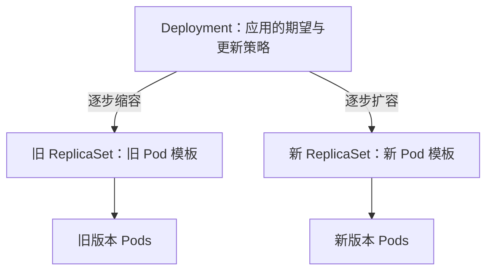

# P22–P25 预习精读：副本控制、标签选择器与 Deployment

整理日期：2026-10-29。用途：助手提前熟悉课程，供用户后续学习时按章节、概念和时间点提问。这份笔记不代表用户已观看、掌握或完成实验。

## 1 来源与读取范围

课程：薪享宏福 Kubernetes v1.29，汪洋授课；BV 号 `BV1PbeueyE8V`。本批完整阅读了四节的 1,757 条中文 AI 字幕，累计视频时长 82 分 12 秒，视频时长不计作用户学习时长。

| 分 P | 官方标题 | CID | 视频时长 | 字幕条数 | 原链接 |
| --- | --- | --- | --- | --- | --- |
| P22 | 第五章.k8sPod控制器-控制器1 | `500001651203929` | 08:53 | 187 | [P22](https://www.bilibili.com/video/BV1PbeueyE8V/?p=22) |
| P23 | 第五章.k8sPod控制器-Pod控制器1 | `500001651204363` | 26:30 | 557 | [P23](https://www.bilibili.com/video/BV1PbeueyE8V/?p=23) |
| P24 | 第五章.k8sPod控制器-Pod控制器2 | `500001651206687` | 17:45 | 358 | [P24](https://www.bilibili.com/video/BV1PbeueyE8V/?p=24) |
| P25 | 第五章.k8sPod控制器-Pod控制器3 | `500001651208340` | 29:04 | 655 | [P25](https://www.bilibili.com/video/BV1PbeueyE8V/?p=25) |

字幕来源：已登录的 yt-dlp Bilibili 提取器，语言 `ai-zh`，再用 `bilibili-obsidian-notes` 的 SRT 解析方式转换。每节的 `source.json`、`transcript.txt` 及原始字幕分别存放在 `.local/bilibili/BV1PbeueyE8V/P022` 至 `P025`；没有混用 P13 的 CID。分 P、标题、时长与内容主题一致，末条字幕分别到 08:47.62、26:29.02、17:39.14、29:03.10；短片尾空白没有被补写成内容。

证据边界：以下“课程主线”来自完整字幕，时间点按字幕定位；不是逐字听写。AI 字幕对英文资源名、文件名和镜像名识别较差，未据此还原课程完整 YAML。主代理已实际查看本组四张关键帧，核对结果单列；本文件据其核对记录修正具体拼写，不声称观看了每一帧或完整音频。本次没有连接三台虚拟机、执行实验或产生新的集群输出。

## 2 P22：控制器为什么要持续工作

### 2.1 课程主线与回查点

| 回查点 | 本段内容 | 抓住的关系 |
| --- | --- | --- |
| [01:23](https://www.bilibili.com/video/BV1PbeueyE8V/?p=22&t=83) | 从“自愈”进入控制器定义：观察当前状态，使其趋近用户期望 | `spec` 表达期望；期望不是执行成功的保证 |
| [02:40](https://www.bilibili.com/video/BV1PbeueyE8V/?p=22&t=160) | 用期望 4 个 Pod、故障后少一个的例子说明补建 | 容器恢复与补建 Pod 是不同层次 |
| [03:46](https://www.bilibili.com/video/BV1PbeueyE8V/?p=22&t=226) | 提到 Node 控制器，并穿插默认 Service 的例子 | 本段职责举例需修正，见下文 |
| [05:50](https://www.bilibili.com/video/BV1PbeueyE8V/?p=22&t=350) | 画出期望 8 个、实际 7 个或 9 个时的比较与调整 | 观察 → 比较 → 补建或删除 → 再观察 |
| [06:55](https://www.bilibili.com/video/BV1PbeueyE8V/?p=22&t=415) | 若硬件只能容纳约 5 个，就不一定能实现期望 8 个 | 控制循环受资源、镜像、配置等现实约束 |
| [07:24](https://www.bilibili.com/video/BV1PbeueyE8V/?p=22&t=444) | 列出 RC、RS、Deployment、DaemonSet、StatefulSet、Job、CronJob、HPA | 这里只是控制器家族预告，不等于本节已讲清各自行为 |

课程在 01:23–02:34 强调：用户提交期望，控制器不断检查并修正偏差。即使写了某个镜像或副本数，镜像不存在、节点资源不够时也不能“凭空达成”。05:47–06:48 的 7、8、9 个副本例子把这种反馈循环具体化。

### 2.2 助手补充：先分清三个“恢复”

| 情况 | 主要负责者与动作 | 观察上要区分什么 |
| --- | --- | --- |
| Pod 内应用进程退出 | kubelet 依据重启策略，配合容器运行时重启容器 | 可能仍是同一个 Pod，容器重启次数增加 |
| 受 RC/RS 管理的 Pod 被删除 | 对应副本控制器创建新的 Pod 对象补足数量 | 新 Pod 有新的 UID，名称通常也改变 |
| 节点失联 | 节点健康检测、驱逐等机制与工作负载控制器协作 | 不保证立即补建；新 Pod 还需调度、启动并达到 Ready |

控制器是运行中的程序，Deployment/ReplicaSet 是 API 对象。提交一个 Deployment 不等于在集群里启动了一个专属于它的“控制器 Pod”。同一类控制器会持续处理很多相应对象。联系既有学习时，可把它接在“API 对象 → 调度 → kubelet → containerd”的链路之前理解。

HPA 也不要与 RS 混为一谈：HPA 根据指标调整目标工作负载的期望副本数，后续才由工作负载控制器落实 Pod 数量；它本身不负责增加 Node。这与既有 P13 中的 HPA／资源分类问题相衔接。

Linux 类比：`systemd` 的 `Restart=` 有助于理解“进程退出后拉起”；跨节点创建替代 Pod 超出了这个类比。简单的 `while` 检查脚本有助于理解反馈循环，但 Kubernetes 控制器还要处理异步事件、并发变化和重试，不能按“某条命令执行一次后就结束”理解。[官方 Controllers](https://kubernetes.io/docs/concepts/architecture/controller/)、[Pod 生命周期](https://kubernetes.io/docs/concepts/workloads/pods/pod-lifecycle/)。

本节两处不要照字面记忆：

- 03:46–04:25 的 Node 控制器与默认 Service 举例，不能推导出“Node 控制器负责自动恢复所有 Service”。不同控制器职责不同；普通应用 Service 被删也不会仅凭 Node 控制器自动恢复。
- 06:32–06:39 提及多余副本优先删除最新 Pod，不能当成确定承诺。RS 缩容还会考虑 Pod 状态、删除成本及分布等因素，创建时间只是部分条件。[官方 RS 缩容说明](https://kubernetes.io/docs/concepts/workloads/controllers/replicaset/#scaling-a-replicaset)。

ASR 注意：字幕中的“空气”等词多处实际指控制器；RC、ReplicaSet 等英文词被音译。Node 控制器与 Service 的具体原话仍需结合课件/音频核对，不据字幕扩展成不存在的职责。

## 3 P23：RC 的三个关键字段，以及标签为什么会改变副本结果

### 3.1 课程主线与回查点

| 回查点 | 本段内容 | 理解重点 |
| --- | --- | --- |
| [03:42](https://www.bilibili.com/video/BV1PbeueyE8V/?p=23&t=222) | 用 vim 编写 RC 清单，解释 `apiVersion: v1`、`kind: ReplicationController` | `rc` 是 kubectl 资源简称，YAML 的 kind 要写完整且区分大小写 |
| [05:34](https://www.bilibili.com/video/BV1PbeueyE8V/?p=23&t=334) | `replicas`、`selector`、`template` 逐层解释 | 要几个、选哪些、缺少时照什么创建 |
| [08:58](https://www.bilibili.com/video/BV1PbeueyE8V/?p=23&t=538) | 容器环境变量、端口与完整 RC 清单，随后粘贴并创建 | Pod 内容嵌套在 `spec.template.spec` 内 |
| [11:29](https://www.bilibili.com/video/BV1PbeueyE8V/?p=23&t=689) | 删除一个 Pod，观察新 Pod 出现、总数仍为 3 | 补建的是替代对象，并非原 Pod 复活 |
| [14:39](https://www.bilibili.com/video/BV1PbeueyE8V/?p=23&t=879) | 显示标签、加 `version` 标签，再覆盖 `app` 标签 | 增加不参与选择的标签与破坏选择条件效果不同 |
| [20:08](https://www.bilibili.com/video/BV1PbeueyE8V/?p=23&t=1208) | `scale` 扩到 10、缩到 5，随后回顾 RC | 改期望数量，由控制器落实；不是手动逐个建删 Pod |
| [23:22](https://www.bilibili.com/video/BV1PbeueyE8V/?p=23&t=1402) | 从 RC 转入 RS，查看 `matchLabels` 与 `matchExpressions` | RS 用 `apps/v1`，更丰富的选择器在 P24 继续 |

03:42–10:18 是资源清单阅读的核心。外层 `spec` 属于 RC；`spec.template.metadata.labels` 描述将要生成的 Pod 标签；`spec.template.spec.containers` 才是容器定义。此前独立 Pod 中学习的探针、生命周期钩子等配置，在控制器里仍放在 Pod 模板的对应位置。

**字段之间的关系**：RC 要求维持 3 个符合选择条件的 Pod；选择条件如 `app: rc-demo`，模板中的 Pod 标签必须满足它；模板还可含 `version: v1` 等额外标签。不能把“选择器标签是模板标签的子集”误记成“两个标签字典必须完全相同”。

10:22–12:36 演示创建与删除一个 Pod 后的补建。13:51–14:35 又明确回到容器退出与 Pod 被删的区别，应以前后合起来的意思理解；02:09 附近概括成“容器退出就由 RC 新建 Pod”过于宽泛。

14:39–20:00 的实验要按选择范围数副本：

1. 原来 3 个 Pod 都有 `app: rc-demo`，满足控制器选择条件。
2. 其中一个新增 `version: v1`，仍保留 `app: rc-demo`，仍被选中，所以不因这次标签增加而补建。
3. 把它的 `app` 改成其他值，匹配的数量变成 2，于是补出一个新的；此刻查询整个命名空间可能看到 4 个 Pod。
4. 改回匹配值后，又可能形成超出期望的情况，控制器缩减至目标数量。这里要结合 ownerReferences 判断归属，不能只数 `kubectl get pods` 的所有行。

### 3.2 助手补充与 Linux/Docker 联系

RC 的三项可类比为“进程/容器的目标数量、匹配规则、启动参数模板”。区别在于 RC 计算的是 Pod 对象，不是 Linux PID，也不是镜像在所有节点的容器总数。一个 Pod 可以有多个容器，所以 `replicas: 3` 不必然等于 3 个容器。

`kubectl get … --show-labels`、`kubectl label … --overwrite`、`kubectl scale … --replicas=…` 是本节命令族；未来在 master 的独立实验命名空间内使用。此处只记录用途，不给本机环境虚构输出。课程清理旧 Service/控制器的步骤不能整段复制到用户的 `default` 命名空间，那里有已有测试应用。

还需校正三点：Pod 名字尾部的随机部分不是课程 11:14 附近所说的“MD5”；端口声明 `containerPort: 80` 不会自动创建 Service；环境变量 `value` 是字符串，像数字的值在自写 YAML 中应写成 `"123"`。这些是助手对 API/对象概念的补充，不能作为已识别出课程画面全部字符的证明。[对象名称](https://kubernetes.io/docs/concepts/overview/working-with-objects/names/)、[容器环境变量](https://kubernetes.io/docs/tasks/inject-data-application/define-environment-variable-container/)。

ASR 注意：`spec`、`template`、`replicas`、`ReplicationController` 多次被识别为近音词。08:58 画面已核对镜像为 `wangyanglinux/myapp:v1.0`、端口 80；但画面中第二个环境变量 `name: zhangsan` 前缺少列表连字符，当前截图不是可直接照抄的完整有效 YAML。其余未核对的字符不能只靠字幕恢复。07:00 附近谈到的“早期版本错误地无限创建”没有核到具体版本或 issue，不记录为确定历史事实。

## 4 P24：RS 的集合选择器、归属关系与 Service 选流量

### 4.1 课程主线与回查点

| 回查点 | 本段内容 | 理解重点 |
| --- | --- | --- |
| [00:41](https://www.bilibili.com/video/BV1PbeueyE8V/?p=24&t=41) | 延续 P23 的 RS，补充选择器与模板标签，创建并验证删除后的补建 | 模板能有额外标签；RS 仍承担副本数控制 |
| [02:46](https://www.bilibili.com/video/BV1PbeueyE8V/?p=24&t=166) | 引入 `In`、`NotIn`、`Exists`、`DoesNotExist`，先演示 `Exists` | “存在 app 这个键”与“app 必须等于某个值”不同 |
| [05:05](https://www.bilibili.com/video/BV1PbeueyE8V/?p=24&t=305) | 讨论为什么不会把其他 RC/RS 的 Pod 都算进来 | 还要看控制器归属；课程“只能管理自己创建的”需要补充 |
| [08:45](https://www.bilibili.com/video/BV1PbeueyE8V/?p=24&t=525) | 用 `In` 给定允许值列表；模板不满足时创建遭拒，之后修正 | 不能写出“控制器造出的 Pod 自己却选不中”的清单 |
| [10:51](https://www.bilibili.com/video/BV1PbeueyE8V/?p=24&t=651) | 已有 Pod 在允许值间切换，然后改为不允许的值 | 列表内仍匹配；列表外触发补建；另有 Pod 消失异常 |
| [12:45](https://www.bilibili.com/video/BV1PbeueyE8V/?p=24&t=765) | 图示一个 RS 的 Pod 用环境标签分给两个 Service | 副本管理选择器和访问流量选择器可以承担不同任务 |
| [16:48](https://www.bilibili.com/video/BV1PbeueyE8V/?p=24&t=1008) | 清理控制器与其 Pod，结束 RS 内容 | 删除受控 Pod 会补建；删除控制器通常触发级联清理 |

02:46–07:59 的 `Exists` 演示是本节第一个转折：若条件只是“存在 app 键”，把 `app` 的值从 A 改成 B 仍满足它。08:06–10:45 换成 `In` 后，值才必须属于指定集合；模板值不在集合里时 API 会拒绝创建。没有写 `replicas` 的演示默认得到 1 个副本，不能由此推断所有对象的缺省字段都相同。

### 4.2 助手补充：把选择器当成明确的判断式

下表是规范化的规则说明，示例值 A/B 为助手抽象，未冒充课程实际拼写。

| 条件 | 判断方式 | 典型误区 |
| --- | --- | --- |
| `matchLabels: {app: demo}` | `app` 键存在且值等于 `demo` | 不是只看键存在 |
| `In`，values 为 `[A, B]` | 键存在，值为 A 或 B | 一个 In 内的候选值是“或” |
| `NotIn`，values 为 `[A, B]` | 不取 A/B；缺少该键也满足 | 若要求键存在，另加 Exists 条件 |
| `Exists` | 有此键即可，不限制值 | 不需要写 values |
| `DoesNotExist` | 没有此键 | 不等于值为空字符串 |

同一个 selector 内不同条件总体按“并且”组合，`matchLabels` 与 `matchExpressions` 也要同时满足。可类比 Linux 筛选命令中的布尔条件，但它作用在对象的标签集合上，不是在容器里搜索文本。[官方 Labels and Selectors](https://kubernetes.io/docs/concepts/overview/working-with-objects/labels/)。

**归属不等于“谁亲手创建”**。RS 通常通过 Pod 的 `metadata.ownerReferences` 与 Pod 建立关系；已有其他 controller owner 的 Pod 不会被另一个 RS 随意抢走，但匹配选择器且没有 controller owner 的孤儿 Pod 可以被 RS 收养。因此 05:05–06:09 的“必须由我创建”需要改成“选择条件与控制器归属共同决定”，也要避免多个控制器选择器重叠。[官方 RS 工作方式及非模板 Pod 收养](https://kubernetes.io/docs/concepts/workloads/controllers/replicaset/#how-a-replicaset-works)。

11:47–12:19 出现“改成不匹配值后，旧 Pod 也被删了”的插曲，讲师将其归因于其他控制器影响。该推测在字幕里没有完整 ownerReferences、Events 或控制器状态证据，笔记保留为待核实的实验异常，不指定究竟哪个控制器做了删除。

12:45–15:14 的 Service 图可以这样理解：RS 用稳定的 `app` 标签维持一组副本；Service 分别用 `env=stable`、`env=test` 选择后端。改某个 Pod 的 `env` 标签，可能使它进入另一条流量选择范围。这是标签用途的组合，不是 Service 拥有这些 Pod，也不是 RS 独有的能力；RC 若只选择稳定的 app 标签，也可与其他标签的 Service 筛选共存。直接改 Pod 标签还不会修改模板，新建的 Pod 会回到模板标签；生产/测试隔离不能只靠两个 Service 标签实现。

Docker 联系：镜像标签如 `myapp:v1.0` 决定拉取哪个镜像引用，Pod 的 `metadata.labels` 决定如何分类/选择，二者都叫“标签”但并非同一种东西。改变 Pod 的 `env` 标签不会把容器镜像自动换成测试版本。

ASR 注意：`Exists`、`In`、`spring-k8s` 等标签值识别有误；08:45 画面核对后，允许值是 `spring-k8s`、`hahahah`，模板却为 `app: sg-k8s`，确实不匹配。这是用于引出错误的清单状态，不是正确示例。镜像核为 `wangyanglinux/myapp:v1.0`，其他未核对的文件名不猜测。结尾“删控制器就都删掉”按默认级联删除理解，存在 orphan 等删除策略例外。

## 5 P25：声明式管理与 Deployment 的两层控制

### 5.1 课程主线与回查点

| 回查点 | 本段内容 | 理解重点 |
| --- | --- | --- |
| [00:54](https://www.bilibili.com/video/BV1PbeueyE8V/?p=25&t=54) | 声明式表达期望结果，命令式表达具体动作；用练琴作类比 | 思维方式与某个资源 kind 不是一一对应 |
| [04:10](https://www.bilibili.com/video/BV1PbeueyE8V/?p=25&t=250) | 比较 `replace` 与 `apply` | 本段“未指定永远保留”和“完全重建”的措辞需修正 |
| [08:58](https://www.bilibili.com/video/BV1PbeueyE8V/?p=25&t=538) | 逐行解释 Deployment 清单、apps/v1 与 selector、两层 labels | 外层 metadata 是 Deployment；template.metadata 是 Pod 模板 |
| [16:03](https://www.bilibili.com/video/BV1PbeueyE8V/?p=25&t=963) | 手动 scale 到 10，改镜像为 v2 后 apply，演示数量保留 | 清单从一开始没有声明 replicas 是理解结果的重要前提 |
| [18:32](https://www.bilibili.com/video/BV1PbeueyE8V/?p=25&t=1112) | 改为 v3 并 replace，演示数量回到缺省 1 | 提交完整替换配置与合并更新的区别 |
| [20:30](https://www.bilibili.com/video/BV1PbeueyE8V/?p=25&t=1230) | 使用 kubectl diff，比对拟提交配置与现存对象 | 与 Linux diff 思路相通；并不证明历史上执行过哪条命令 |
| [27:20](https://www.bilibili.com/video/BV1PbeueyE8V/?p=25&t=1640) | 通过新旧 RS 的副本转移解释滚动更新 | Deployment 管 RS，RS 管 Pod；不是把旧容器原地改成新镜像 |

00:54–03:55 的对比可记为：“我要求最终有 3 个副本”与“现在执行一个创建动作”。04:10–07:43 再用两条命令具体化。这里要区分**提交 API 对象的管理方式**与**控制器持续协调对象的方式**：不是只有 Deployment 才能使用 `apply`，RC/RS 也有期望状态，也可以由清单声明管理；用 `create` 创建 Deployment 后，它依然会持续协调。

08:58–13:15 再次梳理模板层级。Deployment 的外层 `metadata.labels` 是 Deployment 自身标签，不能代替 `spec.template.metadata.labels`；后者才会成为新 Pod 的标签。`spec.selector` 要匹配模板，`apps/v1` 下必须显式设置。课程 10:49–11:21 将“所有其他控制器”笼统归为相同 selector 结构并不精确，例如 CronJob 通过 jobTemplate 管理 Job，不能把 Deployment 的 selector 位置直接套到它上面。

14:42–20:29 的实验先后状态应这样读：

| 步骤 | 课程做了什么 | 课程报告的现象 | 解释时不可丢失的前提 |
| --- | --- | --- | --- |
| 初次创建 | apply 清单，未写 replicas | 1 个副本 | 是 Deployment 默认值 |
| 手动扩容 | scale 到 10 | 10 个副本 | 修改的是在线对象的 replicas |
| 更新 v2 | 原清单只改镜像，再 apply | 镜像更新，仍为 10 个 | 此清单及此前 apply 记录均未管理 replicas |
| 更新 v3 | 原清单改镜像，再 replace | 课程显示副本变回 1 | 缺省 replicas 随完整替换配置重新生效 |

以上是**视频讲述的实验结果**，没有在用户 v1.22.2 集群复现。镜像 v1/v2/v3 的具体返回页面不作为本环境的保证。

### 5.2 助手补充：apply 与 replace 的准确边界

普通客户端 `kubectl apply` 会结合本次文件、在线对象、上次 apply 配置计算更新。某字段从来未在 apply 清单出现，与“之前声明过、这次删掉”是两种情况：后者可能被清除或恢复默认值，不能统称为“没有写就保留”。本节保留手动 scale 结果的结论有其前提。`replace` 则提交完整替换配置；普通 replace 是更新同一个 API 对象，`replace --force` 才包含删除后重建，不能混同。修改 Deployment 模板后出现新 Pod，也不能证明 Deployment 对象本身被删重建。[声明式配置与三方合并](https://kubernetes.io/docs/tasks/manage-kubernetes-objects/declarative-config/#how-different-types-of-fields-are-merged)、[kubectl replace](https://kubernetes.io/docs/reference/kubectl/generated/kubectl_replace/)。

课程为了比较而交替使用 apply/replace，适合观察差异；持续维护同一资源时应选定明确管理方式，避免遗留的 last-applied 记录让后续行为难以解释。`kubectl diff` 无差异只说明这次比较的结果一致，不能证明谁在何时执行过 apply；差异输出是实施前的检查材料，最终运行是否健康仍需另查。[声明式对象管理](https://kubernetes.io/docs/tasks/manage-kubernetes-objects/declarative-config/)。

### 5.3 Deployment → ReplicaSet → Pod

24:26–25:50 先画出初始层级，25:53–29:03 再解释镜像变化后通过新 RS 替代旧 RS 的过程。下面是根据字幕整理的助手示意图，不是课程截图或实测拓扑：

Deployment 模板变更会触发 rollout；单纯改 replicas 不会创建新的发布修订。滚动更新中实际先增后减还是如何分批，受 `maxSurge`、`maxUnavailable`、就绪情况等约束，课程逐个“删旧建新”的图是简化演示。正常完成后旧 RS 可保留为 0 副本以支持回滚，不必自动删除 RS 对象。[官方 Deployment 更新与修订](https://kubernetes.io/docs/concepts/workloads/controllers/deployment/)。

课程 27:39–28:28 用“用户访问不中断”解释滚动更新的目标，不能把它当成无条件保证。就绪探针、应用启动、连接排空、剩余容量以及版本兼容都影响实际可用性。用户已有 Docker 背景，可以把它理解为用新镜像启动一批新实例并逐步替换旧实例，而不是对正在运行的容器执行镜像升级。

ASR 注意：`replace` 被反复识别为 reply，`diff` 被识别为 def/地府，`Deployment`、`ReplicaSet`、`etcd` 等也有音译错误。09:11–09:26 的版本说明应修正为“旧 API 从 v1.16 起不再提供；apps/v1 早在 v1.9 已可用”，不是“v1.16 之前只能用 extensions/v1beta1”。

## 6 与 v1.22.2 实验环境的对应关系

本表使用项目已确认的 v1.22.2 客户端/API Server 记录，未连接刷新。教程为 v1.29；基础行为兼容不意味着所有新版字段、输出列或默认策略都相同。

| 内容 | 本实验的处理方式 |
| --- | --- |
| RC 与 RS/Deployment API | RC 使用 `v1`；RS、Deployment 使用 `apps/v1`。v1.22.2 已不提供课程提到的旧 Deployment beta API；不能为了“旧集群”退回旧清单。 |
| selector 与模板标签 | 本批讨论的 matchLabels、matchExpressions、模板匹配规则可用于 v1.22.2；Deployment 的 apps/v1 selector 创建后不可更改。 |
| apply/replace | 按本节普通客户端 apply 理解三方合并；不要把 Server-Side Apply 的字段所有权细节混在一起。SSA 在 v1.22 已正式稳定，但需要明确选择相应方式。 |
| 缩容顺序 | 不保证最新 Pod 一定先删；PodDeletionCost 自 v1.22 为 beta。这里不依赖它设计实验，也不推断现有特性开关状态。 |
| 副本数与容量 | 两个 Worker 各约 1 GiB；课程扩到 10 的规模不直接照搬。后续学习通常用少量副本观察即可，具体依据当时资源状态。 |
| 容器与网络 | 本实验为 containerd + Flannel；课程的应用控制逻辑不依赖必须使用 Docker/Calico。排查实际容器或网络时仍按本机组件选择工具。 |
| 更新成功的验证 | 对照 Deployment/RS/Pod 状态、事件、Ready 和应用访问；仅 API 请求成功、Pod 有名字或处于 Running，都不能替代完整验证。 |

版本依据：[Kubernetes 官方 v1.16 API 移除公告](https://kubernetes.io/blog/2019/07/18/api-deprecations-in-1-16/)、[Deployment 迁移差异](https://kubernetes.io/docs/reference/using-api/deprecation-guide/#deployment-v116)、[v1.22 Server-Side Apply 正式稳定公告](https://v1-32.docs.kubernetes.io/blog/2021/08/06/server-side-apply-ga/)、[Pod deletion cost 的 v1.22 特性状态](https://v1-32.docs.kubernetes.io/docs/concepts/workloads/controllers/replicaset/#pod-deletion-cost)。本次旧版 `release-1.22` 文档直读遇到获取失败，未把失败页面当作已核对来源；上述版本结论依据官方迁移公告和注明引入版本的文档，不宣称已逐行复核 v1.22.2 源码。

## 7 关键帧核对记录

本组四帧均由主代理实际查看，并反馈下列结果；统一证据与插图见 [P14–P25 关键画面核对](P014-P025-关键画面核对.md)。本表只说明截取时刻可见内容，不把静态图推导成真实集群输出。

| 关键帧 | 已核到的内容 | 使用限制 |
| --- | --- | --- |
| P22 05:50 | 控制循环概念图；期望 replicas 为 8，两节点各画 4 个 Pod | 是原理图，没有真实查询输出 |
| P23 08:58 | RC 名为 `rc-demo`，replicas 为 3，selector 与 template 均为 `app: rc-demo`；镜像 `wangyanglinux/myapp:v1.0`，端口 80 | 第二个环境变量 `name: zhangsan` 前缺列表连字符；不要原样复制这张图为 YAML |
| P24 08:45 | `apps/v1` ReplicaSet，名为 `rs-me-in-demo`；key 为 app，operator 为 In，values 为 `[spring-k8s, hahahah]`；模板为 `app: sg-k8s` | 模板不满足选择器；这时的文件不能作为成功创建示例 |
| P25 27:20 | 手绘中间图：Deployment 的 replicas 为 3、镜像 v2.0；旧 RS replicas 为 2、镜像 v1.0；新橙色 RS replicas 为 1，文字却仍写 v1.0；底部仍有 3 个旧 Pod | 图正在绘制，文字与数量未全部同步。新 RS 若对应 v2.0 模板，其镜像应为 v2.0；不能把该帧当作精确滚动算法或同一时刻真实状态 |

## 8 易问点索引

这是为后续答疑准备的索引，以下并非用户已经提出的新问题。

| 可能的问题 | 回查位置 | 回答需要守住的边界 |
| --- | --- | --- |
| 容器退出与 Pod 被删，谁负责恢复？ | P22 02:40；P23 13:51 | kubelet 重启容器与副本控制器补建对象分开 |
| 为什么写 3 副本，却看到 4 个 Pod？ | P23 16:04 | 全命名空间数量、标签匹配数量与 ownerReferences 分开 |
| selector 与模板标签必须完全相同吗？ | P23 05:54；P24 00:41 | 模板必须满足全部条件，仍可有额外标签 |
| Exists 和 In 的区别是什么？ | P24 02:46、08:45 | 键存在与值落入集合分开 |
| RS 能管理手工创建的 Pod 吗？ | P24 05:05 | 可以收养符合条件的孤儿 Pod，不抢已有 controller owner 的 Pod |
| 改 Pod 标签为什么会改变访问路径？ | P24 12:45 | Service 选后端；标签变化不自动修改镜像或模板 |
| apply 为什么没有把 10 个副本改回 1 个？ | P25 16:03 | 本例 replicas 从未由该 apply 清单声明 |
| 从文件中删一个字段，apply 会保留吗？ | P25 04:10 对照助手补充 | 要结合上次 apply 记录，不能只看当前文件 |
| replace 会把 Deployment 删掉重建吗？ | P25 18:32 | 普通更新与 --force 删除重建分开 |
| 为什么 Deployment 中间还有 RS？ | P25 24:26–29:03 | RS 负责一版模板的副本，Deployment 协调新旧 RS |
| scale 为什么没有出现新的 RS？ | P25 更新图及助手补充 | 模板更新与副本数量变化分开 |
| 滚动更新能保证没有一次请求失败吗？ | P25 27:39 | 目标是降低中断，仍依赖探针、容量与应用行为 |

## 9 学习中的问题与解答

本批是助手预习，暂无针对 P22–P25 新发生的用户问答或新增实操验证。已有用户问答保留在 [P13 笔记](P013-什么是资源.md) 与 [学习暂存](../PENDING.md)，不在这里改写成已解决，也不把上方“易问点”当作用户已问过的问题。

用户掌握状态：以 [PROGRESS.md](../PROGRESS.md) 的既有证据为准；本次提前读字幕不改变观看位置和掌握程度。后续用户实际提问时，再追加问题原意、解答、验证结果与解决状态。
